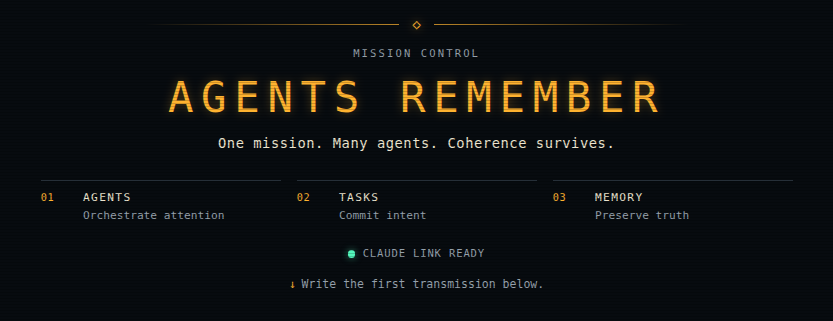

<h1 align="center">
  Agents Remember
</h1>
<h3 align="center">
  Git-verified records for what your coding agents know. A control plane for what they do.
</h3>

<p align="center">
  
</p>

<p align="center">
  
</p>

A coding agent fixes the bug it was shown and misses the other places that hold the same rule,
because a search sees only the path it follows. Agents Remember gives the repository a memory in
a Git repository of its own: a note at the path of each file, records that tie each rule to all
the code that expresses it, and role agents that let a change land only when code and memory
agree. It is for developers and teams who work with coding agents on codebases too large for one
context window.

https://github.com/user-attachments/assets/87d905c4-cfe6-455e-9210-46da1fd39247

<p align="center">
  <a href="assets/agents-remember-explainer.mp4">Watch the explainer video</a> (2 min 34 s, with music, no narration).
</p>

The documentation is in [`docs/`](docs/README.md); start with
[Getting started](docs/getting-started.md). The site
https://foxfire1st.github.io/agents-remember/ shows the folder `docs/` of the branch `main`, and
https://foxfire1st.github.io/agents-remember/llms.txt is its summary for machine readers.

## Contents

1. [The problem](#the-problem)
2. [What Agents Remember does](#what-agents-remember-does)
3. [Where it is heading](#where-it-is-heading)
4. [What you need](#what-you-need)
5. [Install steps](#install-steps)
6. [Start and stop the dashboard and the host](#start-and-stop-the-dashboard-and-the-host)
7. [Documentation](#documentation)
8. [A live example](#a-live-example)
9. [Status](#status)
10. [Stability](#stability)
11. [Contributing](#contributing)

## The problem

Code that belongs together often lies in different folders, under different names, written months
apart. An agent that searches from the top of the tree opens some paths and never sees the others.
It fixes one place, the tests pass, and three other places still break the same rule.

The rules that make an edit safe are not in the file the agent edits. An instruction file at the
top of the repository is read at the start of a session. It is not at hand later, at the moment
the agent decides how to change one file deep in the tree.

## What Agents Remember does

Everything in this section describes the product as it is in this repository.

- **A card at the path of the file.** The memory repository holds a card for a source file at the
  file's own path. An agent that holds a file reaches its card without a search and without a
  ranking. In this example the folder `ar-<id>` is the memory repository of the code repository:

  ```text
  <code-repository>/src/orchestrator/core_editor.py
  <coordination-root>/memory-repos/ar-<id>/onboarding/src/orchestrator/core_editor.py.md
  ```

- **Rules with all their places.** A knowledge record states one rule, called an
  [invariant](docs/concepts.md#invariant). Cards name the code that realizes it and the tests
  that prove it, and a [family](docs/concepts.md#family) groups the invariants that give one
  guarantee together. From one file an agent reaches the rule, and from the rule every other
  place that holds it.
- **Decisions with what was rejected.** A decision record keeps the alternatives that were
  rejected or deferred, each with its reason and the condition under which to reconsider it.
- **Checked against the code.** Each card anchors its statements to lines and symbols of the
  code. A check finds every [anchor](docs/concepts.md#anchor) whose code has changed, and a task
  neither closes out nor lands with memory that holds a stale anchor.
- **Memory that lands with the code.** The memory is a Git repository of its own, outside the code
  repository. A task works in a code worktree and a memory worktree side by side. Closeout commits
  both, after the [knowledge gate](docs/concepts.md#knowledge-gate) has compared the changed
  code with the changed memory. The gate has no waiver.
- **Roles with separate duties.** An Architect writes the requirement with you. A Worker builds
  the change, a Reviewer judges it, and a Curator records what the change means for the memory. A
  Manager coordinates the tasks of one [master](docs/concepts.md#master), which is a group of
  tasks.
- **A host that runs the role agents.** Agents Remember installs and starts the host, Paseo. The
  host runs each role agent in a harness such as Claude Code or Codex and shows its chat.
- **The intent review.** The button "⇄ Intent review" on a task's page opens the review of that
  task. The review compares the code and the memory before and after the change and shows the
  change by the rules it touches: the invariants and families that the change added, changed or
  removed, the code and the proofs recorded for each, and the changed files that no knowledge
  record covers. You ask questions on the page. An explainer agent answers in a chat or with a
  page of its own, and on request it grades the parts of the change, so that you read the
  important parts first. To publish a page, the explainer needs Playwright and its browser on
  your machine: see
  [what the explainer needs](docs/guides/review-page-and-explainer.md#what-the-explainer-needs-before-it-can-publish). Nothing starts on a new task until its task document records your `go`.
- **A dashboard.** A local web page shows the chats of the role agents, the tasks with their steps
  and reviews, the knowledge of a repository and its files. From it you start a role agent, read
  a task document and open the intent review.
- **The repository's own instructions.** The folder `system/` of the memory repository holds the
  path rules, tools, coding guidelines and sources of one code repository, so each harness works
  by the same rules. Its settings can name another repository, whose code and memory the context
  of this repository then includes while that repository is on the branch the entry expects.
- **A benchmark runner.** The package holds a benchmark runner, and the repository holds one case
  for it. For a case the runner prepares one environment with the source only and one with the
  memory, so that a run with the memory can be compared with a run without it.

[Features](docs/features.md) gives the tour, and [Concepts](docs/concepts.md) defines the terms.

## Where it is heading

The model that Agents Remember applies to code can be adapted to other subjects. Three directions
lie beyond code:

- **Research.** A versioned map of a field's claims, hypotheses, experiments and evidence, built
  toward a goal and updated by each new publication.
- **Model weights.** A checked, versioned map of what the parts of a neural network do, for
  networks that fit in no context window.
- **Organisations.** Decisions that keep their reasons, their assumptions and the conditions for
  opening them again.

The product does none of the three today. The [Roadmap](ROADMAP.md) gives one picture for each
direction, names the part of today's product that it builds on, and lists the nearer directions
for code. It holds directions and ideas, not commitments.

## What you need

- A Linux x86_64 machine. WSL 2 on Windows counts as Linux.
- Python 3.14 (`>=3.14,<3.15`), [uv](https://docs.astral.sh/uv/) and Git.
- One harness, installed and logged in: Claude Code, Codex, Cursor, Hermes, Pi or OpenClaw. The
  host starts no role agent on Cursor or OpenClaw.
- Network access during the setup, and the free ports 8765 and 8766 on the loopback address.

Docker is not needed. [Getting started](docs/getting-started.md#what-you-need) gives the details.

## Install steps

[Getting started](docs/getting-started.md) tells these five steps in full. The page
[Install](docs/install/README.md) links the page of each harness.

1. **Install the package.** Install the published package with one command:

   ```bash
   uv tool install --python 3.14 agents-remember-mcp
   ```

   [Getting started](docs/getting-started.md#1-install-the-package) also tells how to build and
   install the package from a checkout of this repository.

2. **Write the settings file.** Create `~/.config/agents-remember/agents-remember-settings.json`.
   It names the workspace root, the coordination root and your code repositories:

   ```json
   {
     "coordinationRoot": "/home/<you>/projects/ar-coordination",
     "workspaceRoot": "/home/<you>/projects",
     "repositories": { "my-repo": {} }
   }
   ```

3. **Register the tool server in your harness.** The harness starts the command
   `agents-remember-mcp` with the arguments `--config` and the full path of the settings file.
   Restart the harness.
4. **Start the setup.** In a chat of that harness, ask the agent to make one call:

   ```text
   role_start(role="bootstrap", request_id="<a new UUID>")
   ```

   The call creates the coordination root, installs and starts the host, starts one role agent
   in the role Bootstrap and starts the dashboard.
5. **Open the dashboard.** Open the address that the answer names, by default
   `http://127.0.0.1:8765/`, and continue the setup in the chat of the Bootstrap role agent.

## Start and stop the dashboard and the host

The setup starts both. Afterwards these commands start, check and stop them:

```bash
agents-remember dashboard --daemon    # start the dashboard and the installed host
agents-remember dashboard --status    # state of both; exit 0 when both run
agents-remember dashboard --stop      # stop the dashboard; the host keeps running
agents-remember paseo status --config ~/.config/agents-remember/agents-remember-settings.json
agents-remember paseo stop --config ~/.config/agents-remember/agents-remember-settings.json
```

`paseo stop` stops the host. Open sessions close, and running turns and open permission prompts
are lost. `agents-remember dashboard --daemon` starts the host again.
[The Host](docs/host.md) describes the commands, the ports and an update of the install.
[The Dashboard](docs/dashboard.md) describes every tab.

## Documentation

- [Agents Remember Documentation](docs/README.md): the index of every page.
- [Getting started](docs/getting-started.md): the install steps in full, the setup of a
  repository and the first task.
- [Install](docs/install/README.md): the page of each harness and what the harness needs.
- [The Host](docs/host.md) and [The Dashboard](docs/dashboard.md).
- [Roles and role agents](docs/roles.md) and [Workflows](docs/workflows.md): who does what, and
  how a request becomes a landed change.
- [Concepts](docs/concepts.md) and [Features](docs/features.md).
- [Guides](docs/guides/README.md) and [Reference](docs/reference/README.md), with the
  [MCP Tool Reference](docs/reference/mcp-tools.md) and the
  [Settings Reference](docs/reference/settings-json.md).
- [FAQ](docs/FAQ.md).

## A live example

Agents Remember is developed with Agents Remember. The memory repository of this repository is
public: https://github.com/Foxfire1st/ar-agents-remember. Its folder `onboarding/` holds the cards
of this repository's files.

## Status

The version of the package in this repository is `3.0.0`. It requires Python 3.14.

Agents Remember is under active development. The contracts listed under [Stability](#stability)
change only with a major version. Everything else may change between versions, so read the notes
of your target version in [GitHub Releases](https://github.com/Foxfire1st/agents-remember/releases)
before an update. Each harness page says what was verified on an installed version of the harness
and what is taken from the vendor's documentation.

## Stability

Following semantic versioning from `1.0.0`, these public contracts will not change without a **major** version bump: **skill IDs** (e.g. the `l-01-agent-lifecycles` [skill](docs/concepts.md#skill)), **MCP tool names and their inputs/outputs**, the **layout of the coordination root and of the memory repositories under `memory-repos/ar-<id>/`**, and the **settings schema**. Internal modules, provider internals, and prompt wording are not part of this promise and may change in minor releases.

## Contributing

[Contributing to Agents Remember](CONTRIBUTING.md) describes the development setup, the checks and
the rules for a change. The [code of conduct](CODE_OF_CONDUCT.md) and the
[security policy](SECURITY.md) apply. The license is [MIT](LICENSE).
