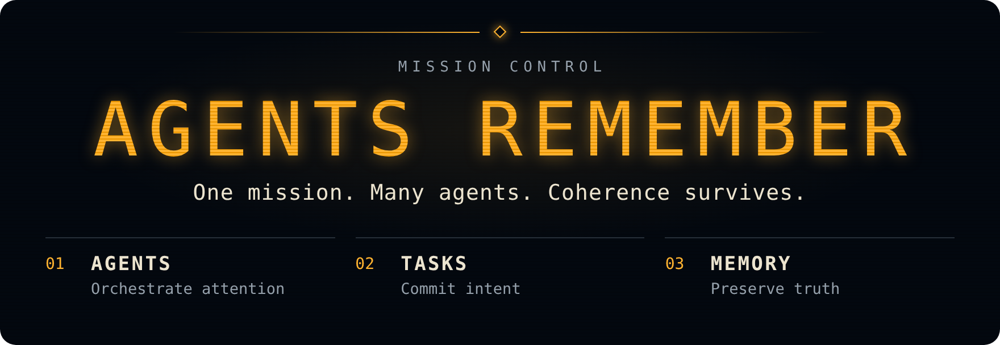
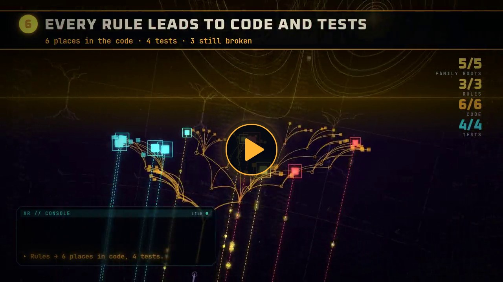
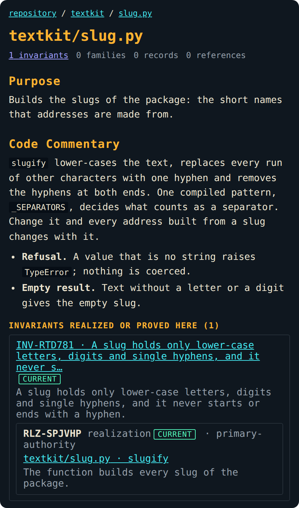
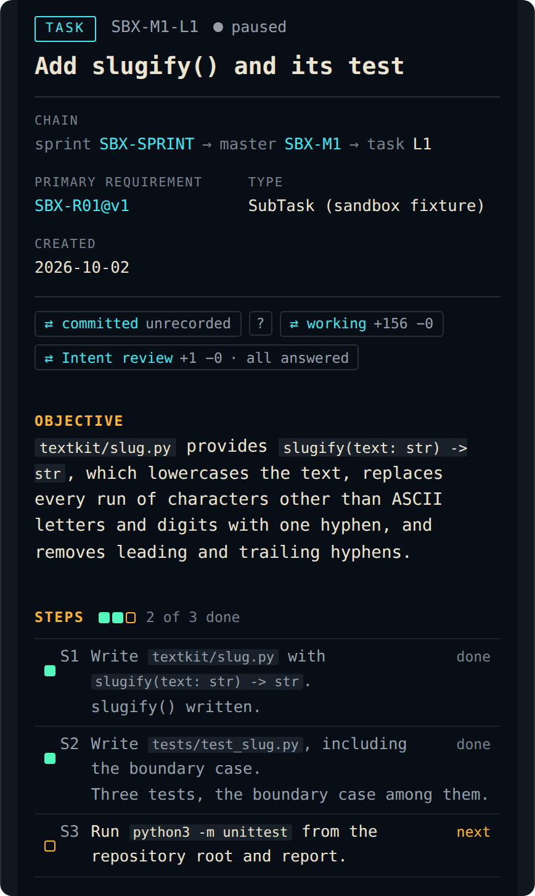
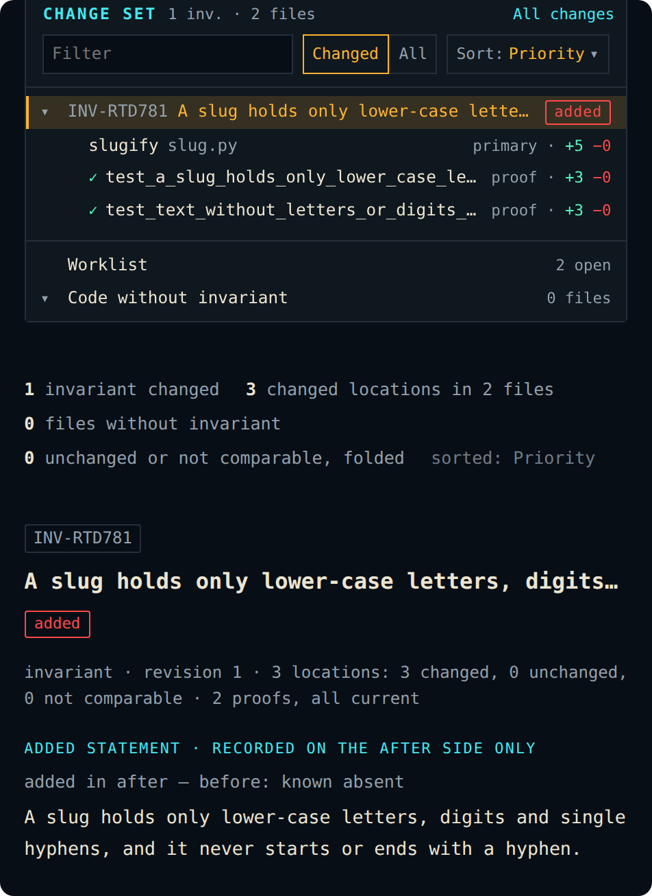

<h1 align="center"></h1>

<h3 align="center">Git-verified records for what your coding agents know. A control plane for what they do.</h3>

<p align="center">
  <a href="https://pypi.org/project/agents-remember-mcp/"></a>
  <a href="mcp/pyproject.toml"></a>
  <a href="LICENSE"></a>
</p>

<div align="center">

[**Getting started**](docs/getting-started.md) ·
[**Documentation**](https://foxfire1st.github.io/agents-remember/) ·
[**Features**](docs/features.md) ·
[**Roadmap**](ROADMAP.md) ·
[**Releases**](https://github.com/Foxfire1st/agents-remember/releases)

</div>

<p align="center">
  A coding agent fixes the bug it was shown and misses the other places that hold the same rule,
  because a search sees only the path it follows. Agents Remember gives the repository a memory in
  a Git repository of its own: a note at the path of each file, records that tie each rule to all
  the code that expresses it, and agents in separate roles that let a change land only when code
  and memory agree. It is for developers and teams who work with coding agents on codebases too
  large for one context window.
</p>

<p align="center">
  <a href="https://foxfire1st.github.io/agents-remember/assets/agents-remember-explainer.mp4"></a>
</p>

<p align="center">
  The explainer video: 2 min 34 s, with music, no narration.
</p>

## What goes wrong without it

An agent knows the files it opened, and the rule it breaks can stand in a file it never opened.

Code that belongs together often lies in different folders, under different names, written months
apart. An agent that searches from the top of the tree opens some paths and never sees the others.
It fixes one place, the tests pass, and three other places still break the same rule.

The rules that make an edit safe are not in the file the agent edits. An instruction file at the
top of the repository is read at the start of a session. It is not at hand later, at the moment
the agent decides how to change one file deep in the tree.

## What Agents Remember does

Agents Remember records the rules of the code where an agent finds them, checks the records
against the code, and runs every change as a task that brings code and memory forward together.

Everything in this section is in the product today, and one result is open to read: Agents
Remember is developed with Agents Remember, and the
[memory repository](docs/concepts.md#memory-repository) of this repository is public at
[Foxfire1st/ar-agents-remember](https://github.com/Foxfire1st/ar-agents-remember). Its folder
`onboarding/` holds the [cards](docs/concepts.md#card) of this repository's files.

- **A card at the path of the file.** The memory repository holds a card for a source file at the
  file's own path. An agent that holds a file reaches its card without a search and without a
  ranking.
- **Rules with all their places.** A [knowledge record](docs/concepts.md#knowledge-record) states
  one rule, called an [invariant](docs/concepts.md#invariant), and cards name the code that
  realizes it and the tests that prove it. From one file an agent reaches the rule, and from the
  rule every other place that holds it.
- **Checked against the code.** Each card anchors its statements to lines and symbols of the
  code. A check finds every [anchor](docs/concepts.md#anchor) whose code has changed, and a
  [task](docs/concepts.md#task) neither [closes out](docs/concepts.md#closeout) nor
  [lands](docs/concepts.md#landing) with memory that holds a stale anchor.

<p align="center">
  <br>
  <em>The Knowledge page of the <a href="docs/concepts.md#dashboard">dashboard</a> for one file: its card and, under it, the rule that the file realizes.</em>
</p>

- **Roles with separate duties.** An Architect writes the requirement with you, a Worker builds
  the change, a Reviewer judges it, and a Curator records what the change means for the memory.
  Each [role](docs/concepts.md#role) is filled by a [role agent](docs/concepts.md#role-agent)
  that the [host](docs/concepts.md#host), Paseo, runs in a [harness](docs/concepts.md#harness)
  such as Claude Code or Codex.
- **Memory that lands with the code.** The memory is a Git repository of its own, outside the code
  repository, and a task works in a code worktree and a memory worktree side by side. Closeout
  commits both, after the [knowledge gate](docs/concepts.md#knowledge-gate) has compared the
  changed code with the changed memory, and the gate has no waiver.

<p align="center">
  <br>
  <em>The page of a task: what the task is to reach, the state of its review, and its steps, two of three done.</em>
</p>

- **The intent review.** The [intent review](docs/concepts.md#intent-review) of a task compares
  the code and the memory before and after the change and shows the change by the rules it
  touches: the invariants and [families](docs/concepts.md#family) that the change added, changed
  or removed, the code and the [proofs](docs/concepts.md#realization-and-proof) recorded for
  each, and the changed files that no knowledge record covers. You ask questions on the page, an
  [explainer](docs/concepts.md#explainer) agent answers, and nothing starts on a new task until
  its [task document](docs/concepts.md#task-document) records your `go`.

<p align="center">
  <br>
  <em>The intent review of that task: the rule that the change added, the code that realizes it, the two tests that prove it, and the rule's statement.</em>
</p>

There is more: [decision records](docs/concepts.md#knowledge-record) that keep each rejected or
deferred alternative with its reason and the condition under which to reconsider it, the tabs of
the dashboard, the repository's own instructions in the folder `system/`, and a
[benchmark runner](docs/concepts.md#benchmark-runner) with one case in this repository.
[Features](docs/features.md) gives the tour, and
[The review page and the explainer](docs/guides/review-page-and-explainer.md) is the guide to the
intent review.

## Try it

Five steps lead from the install of the package to the dashboard in your browser. You need:

- A Linux x86_64 machine. WSL 2 on Windows counts as Linux.
- Python 3.14 (`>=3.14,<3.15`), [uv](https://docs.astral.sh/uv/) and Git.
- One harness, installed and logged in: Claude Code, Codex, Cursor, Hermes, Pi or OpenClaw. The
  host starts no role agent on Cursor or OpenClaw.
- Network access during the setup, and the free ports 8765 and 8766 on the loopback address.

Docker is not needed. [Getting started](docs/getting-started.md#what-you-need) gives the details.

### Install steps

[Getting started](docs/getting-started.md) tells these five steps in full. The page
[Install](docs/install/README.md) links the page of each harness, which shows how the
[tool server](docs/concepts.md#tool-server) is registered in it.

1. **Install the package.** Install the published package with one command:

   ```bash
   uv tool install --python 3.14 agents-remember-mcp
   ```

   [Getting started](docs/getting-started.md#1-install-the-package) also tells how to build and
   install the package from a checkout of this repository.

2. **Write the settings file.** Create `~/.config/agents-remember/agents-remember-settings.json`,
   the [settings file](docs/concepts.md#settings-file). It names the
   [workspace root](docs/concepts.md#workspace-root), the
   [coordination root](docs/concepts.md#coordination-root) and your
   [code repositories](docs/concepts.md#code-repository):

   ```json
   {
     "coordinationRoot": "/home/<you>/projects/ar-coordination",
     "workspaceRoot": "/home/<you>/projects",
     "repositories": { "my-repo": {} }
   }
   ```

3. **Register the tool server in your harness.** The harness starts the command
   `agents-remember-mcp` with the arguments `--config` and the full path of the settings file.
   Restart the harness.
4. **Start the setup.** In a [chat](docs/concepts.md#chat) of that harness, ask the agent to make
   one call:

   ```text
   role_start(role="bootstrap", request_id="<a new UUID>")
   ```

   The call creates the coordination root, installs and starts the host, starts one role agent
   in the role Bootstrap and starts the dashboard.
5. **Open the dashboard.** Open the address that the answer names, by default
   `http://127.0.0.1:8765/`, and continue the setup in the chat of the Bootstrap role agent.

From there [Getting started](docs/getting-started.md#set-up-a-repository-with-bootstrap) goes on
with the setup of a repository and the first task. [The Host](docs/host.md#stop-and-start) gives
the commands that start, check and stop the dashboard and the host.

## Documentation

The documentation is in [`docs/`](docs/README.md), and
[the documentation site](https://foxfire1st.github.io/agents-remember/) shows that folder as it
is on the branch `main`.

- [Getting started](docs/getting-started.md): the install steps in full, the setup of a
  repository and the first task.
- [Concepts](docs/concepts.md) defines every term, and [Features](docs/features.md) tours the
  product part by part.
- [Roles and role agents](docs/roles.md) and [Workflows](docs/workflows.md): who does what, and
  how a request becomes a landed change.
- [The Host](docs/host.md) describes the commands, the ports and an update of the install, and
  [The Dashboard](docs/dashboard.md) describes every tab.
- [The index](docs/README.md) links every page, among them the guides, the reference and the FAQ.
- [llms.txt](https://foxfire1st.github.io/agents-remember/llms.txt) is the summary of the site
  for machine readers.

## Status

The version of the package in this repository is `3.0.1`. It requires Python 3.14.

Agents Remember is under active development. The contracts of the stability promise below change
only with a major version. Everything else may change between versions, so read the notes of a
version in [GitHub Releases](https://github.com/Foxfire1st/agents-remember/releases) before you
install it. Each [harness page](docs/install/README.md) says what was verified on an installed
version of the harness and what is taken from the vendor's documentation.

<details>
<summary><b>The stability promise</b></summary>

Following semantic versioning from `1.0.0`, these public contracts will not change without a **major** version bump: **skill IDs** (e.g. the `l-01-agent-lifecycles` [skill](docs/concepts.md#skill)), **MCP tool names and their inputs/outputs**, the **layout of the coordination root and of the memory repositories under `memory-repos/ar-<id>/`**, and the **settings schema**. Internal modules, provider internals, and prompt wording are not part of this promise and may change in minor releases.

</details>

## Where it is heading

The model that Agents Remember applies to code can be adapted to other subjects, and three
directions lie beyond code: research, model weights and organisations. The product does none of
the three today. The [Roadmap](ROADMAP.md) gives one picture for each direction, names the part
of today's product that it builds on, and lists the nearer directions for code. It holds
directions and ideas, not commitments.

## Contributing

[Contributing to Agents Remember](CONTRIBUTING.md) describes the development setup, the checks and
the rules for a change. The [code of conduct](CODE_OF_CONDUCT.md) and the
[security policy](SECURITY.md) apply. The license is [MIT](LICENSE).
