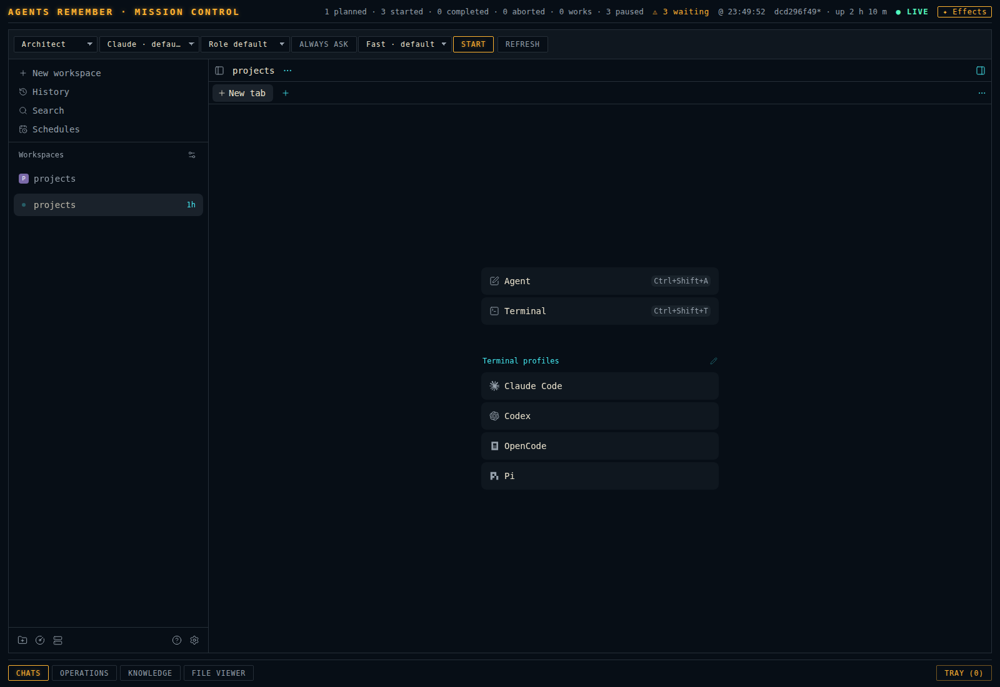
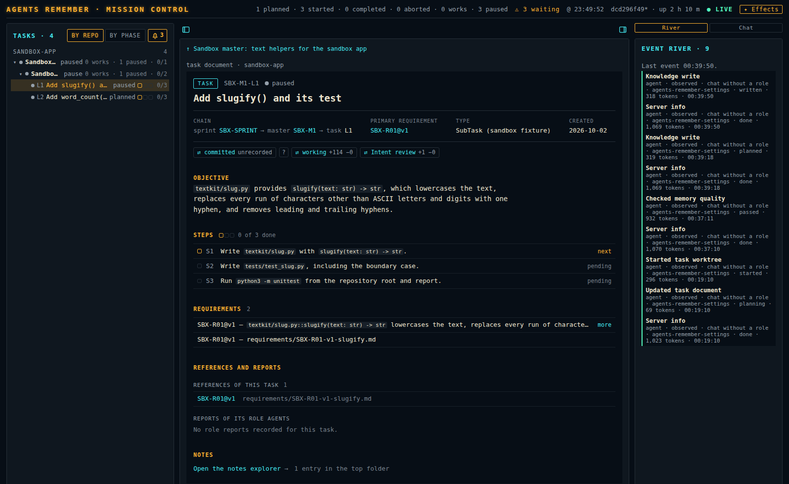
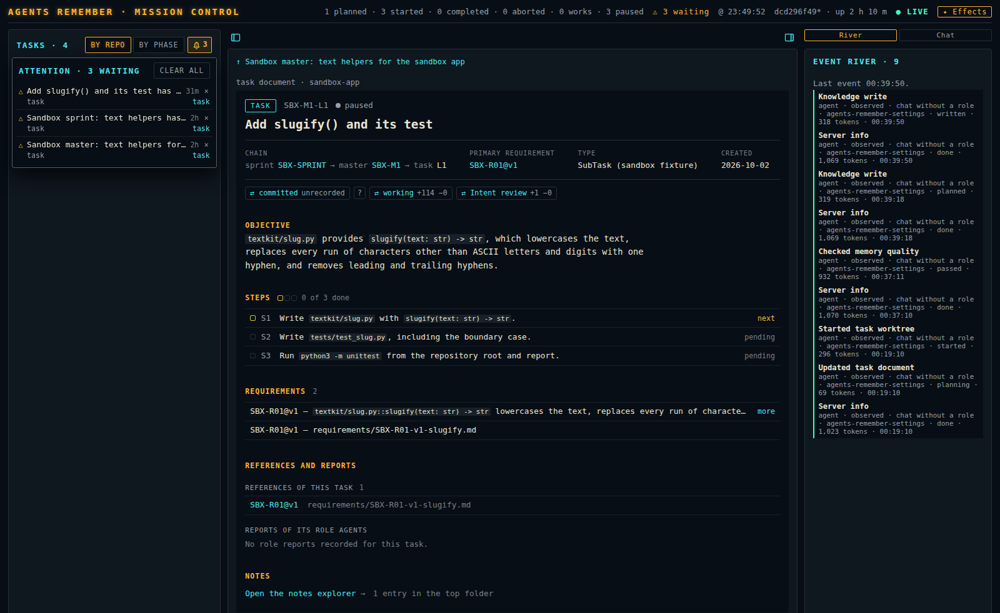

# The Dashboard

The dashboard is the local web page of Agents Remember. A user starts role agents there, talks
to them in the chats of the host, follows the task documents of every registered code
repository, and reads a repository's knowledge.

This page names each part of the dashboard by the label the dashboard shows and says what a user
does there. A label in double quotes is the text on the screen. A selector without a visible
title is named by its accessible name, which a screen reader announces.

## Open the dashboard

```bash
agents-remember dashboard
```

The command serves the dashboard at `http://127.0.0.1:8765/`. The port is the value of the
option `--port`, else the value of the settings key `dashboard.port`, else 8765. The dashboard's
server binds `127.0.0.1` unless the option `--host` names another address; the help text of
`--host` says not to expose the dashboard.

| Option | What it does |
| --- | --- |
| `--host` | The address the dashboard's server binds. The default is `127.0.0.1`. |
| `--daemon` | Starts the dashboard in the background and starts the installed host with it. |
| `--status` | Reports the state of the dashboard and of the host and prints the dashboard's background-work totals. |
| `--stop` | Stops the background dashboard. The host and its role agents keep running. |

[Getting started](getting-started.md) tells the installation. [The host](host.md) describes the
host, which is Paseo.

The dashboard is one page at one address. Selecting a tab, a task or a chat does not change the
address. The Knowledge page and the review page write their place into the address; see
[Addresses and keys](#addresses-and-keys).

## The page at a glance



The page has three parts: the top bar, the page of the selected tab, and the tab bar at the
bottom.

### The top bar

| Part | What it shows |
| --- | --- |
| "AGENTS REMEMBER · MISSION CONTROL" | The title. |
| Counts line | "N planned · N started · N completed · N aborted · N works · N paused", counted over all tasks. "N waiting" stands before "N paused" while at least one task waits. |
| "⚠ N waiting" | The number of entries in the attention bell. The chip shows only while the bell holds an entry. |
| "@ HH:MM:SS" | The time of the state the page shows. |
| Build stamp | The version or commit of the serving dashboard, how long the dashboard's server has run, and one of `current`, `stale` or `unknown`. |
| "● LIVE", "… CONNECTING", "✶ SIGNAL LOST" | The connection of the page to the dashboard's server. |
| "✦ Effects" / "❄ Calm" | A switch. "Calm" freezes motion and the backdrop. The address parameter `?effects=off` does the same for one load. |

When the dashboard does not know the activity of the host, the counts line leaves out "works",
"waiting" and "paused" and ends with "host activity unavailable".

When the hover text of the build stamp ends with "client bundle differs from the serving build —
reload to update", reload the page in the browser.

### The tab bar

The tab bar holds four tabs in this order. The dashboard opens on "Chats".

| Tab | Page |
| --- | --- |
| "Chats" | The role launcher and the [chat frame](concepts.md#chat-frame). |
| "Operations" | The task list, the task document, and the event river or the chat of the selected document. The review page opens inside this tab. |
| "Knowledge" | The reader of a repository's knowledge. |
| "File Viewer" | A code file beside its card. |

Beside the tabs stands the button "Tray (n)", where n is the number of picks in the tray. It is
not a tab; see [The tray](#the-tray).

Each tab keeps its page loaded while another tab shows. A user who returns to a tab finds the
page as it was left: the chat, the selected task, the knowledge view and the open file.

### Sidebar toggles

Every sidebar of every page has one toggle of the same look at the edge of the main column. Its
hover text reads "Hide" or "Show" with the name of the sidebar. The browser remembers the state
of each sidebar per page and side.

| Page | Toggles |
| --- | --- |
| Operations | "Task list sidebar", "River and chat sidebar" |
| Knowledge | "Tree sidebar", "Outline sidebar" |
| File Viewer | "Explorer sidebar" |
| Notes reader | "Notes sidebar" or "Requirements sidebar" |
| Change-set page | "Changed files sidebar" |
| Review page | "Tree sidebar", "Chat sidebar" |

The chat sidebar of the review page is the one exception: it is closed each time a review opens.

### Narrow screens

At a width of 40rem and less the body of the dashboard is one column. The Knowledge page then
shows a button "Browse" or "Document" that switches between the tree and the document, and a
diff starts in the inline form.

## Chats

The "Chats" page has two parts: the role launcher in one row, and under it the chat frame, which
shows the host's page.

### The role launcher

The role launcher starts a role agent on the host. It is one row of selectors, chips and
buttons in the look of the tabs. The row wraps by whole controls when they do not fit, so every
control stays visible.

The selectors carry no visible title. The agent selector chooses the [harness](concepts.md#harness)
of the role agent; the dashboard calls a harness that the host can start an agent.

The hover text of the agent, model and effort selectors reads "<shown value> — <key>: <value> ·
<source>". There <key> is "agent", "model" or "effort", <value> is the role's default, and
<source> names where the default comes from: "our settings" for the role settings, "host role"
for the [host profile](concepts.md#host-profile) of the role, or "host default".

| Control | Accessible name | What it offers | When it shows |
| --- | --- | --- | --- |
| Role | "Role" | "Architect", "Investigator", "Orchestrator", "Manager", "Worker", "Reviewer", "Curator". The launcher opens on "Architect". | Always. |
| Sprint | "AR sprint" | The sprint documents; "Select sprint…", or "No sprint documents". | For Orchestrator, Manager, Worker, Reviewer and Curator. |
| Master | "AR master" | The masters of the chosen sprint; "Select master…", or "No linked masters". | For Manager, Worker, Reviewer and Curator, after a sprint is chosen. |
| Task | "AR task" | The tasks of the chosen master; "Select task…", or "No leaf tasks". | For Worker, Reviewer and Curator, after a master is chosen. |
| Agent | "Role agent override" | First "<agent> · default" or "Role default", the role's default harness; then every harness that the host knows. | Always. |
| Model | "Role model override" | First "<model> · default", "Role default" or "Agent default"; then the models of the selected harness. | Always. |
| Effort | "Role effort override" | First "<effort> · default", "Model default" or "Role default"; then the efforts of the selected model. | While the selected model offers efforts. |
| Mode | a chip | The [permission mode](concepts.md#permission-mode) the role agent starts in, by the label the host gives it, or "none stated". The hover text names where it comes from, for example "our settings", and adds the host's description of it. | Always. |
| Instructions | chip "Instructions" | The hover text names where the user instructions come from and says whether they replace the baseline or are added to it. | When the role settings hold user instructions. |
| Features | "<feature> override" | "<feature> · default", then "On" and "Off" or the options of the feature. | One selector per feature the selected model offers. |
| Speed | chip "Speed: <tier>" | The service tier of the role. | When the role settings state a service tier. |

Some texts of the dashboard say "leaf" for a [task](concepts.md#task), for example "No leaf tasks".

The launcher offers seven roles. Bootstrap is not among them. [Roles](roles.md) describes each
role and the document it works on.

The model selector can show a placeholder in place of a choice: "Pick an agent first", "Agent
capabilities loading" or "No model choices".

When the selected harness is not the role's default harness, the mode chip reads "At start": the
permission mode is resolved for the selected harness at the start. The speed chip then reads
"Speed: provider default": the service tier of the role applies only on the role's own harness.

A feature that bears on permissions is a chip and cannot be changed in the launcher. Its hover
text ends with "set in the user's settings".

The defaults of a role come from the role settings in the user settings file, not from the
host. A choice in the launcher changes no role setting.
[Harnesses](reference/harnesses.md) and the [settings reference](reference/settings-json.md)
describe the role settings.

#### The buttons

| Button | What it does | When it shows |
| --- | --- | --- |
| "Start" | Starts the role agent for the selection. While the start runs the button reads "Preparing workspace…" and then "Starting agent…". The chat below then shows the started agent. | Always. |
| "Retry" | Repeats the same saved start request. | While the last start left a request that can be repeated. |
| "Step up" | Asks "Why does this seat need its configured step-up? Give one sentence." and starts the role with the configured step-up and that reason. | When the role settings name a step-up. |
| "Revive" | Resumes a closed role agent as the same agent. No message is sent. | For a run whose agent the host still has, not archived, with its session closed: always when the session closed while a turn was open, otherwise only while no earlier resume of it was refused. |
| "Result" | Reads the result of the selected role's run and opens its report in the [notes reader](#the-notes-reader). | When the selection is complete and a run exists for it. |
| "Retry launch options" | Loads the choices again. | After the choices could not be loaded. |
| "Refresh" | Asks the host for its list of harnesses and models again. | Always. |

After a start with a step-up the row shows the chips "Stepped-up · <model>" and "Mode/features
unreported", and the other chips begin with "Base · ".

"Start" is off while the selection is incomplete, while the choices are not loaded, while a
start runs, and while the failure line names a problem with a choice. For Worker, Reviewer and
Curator it is also off while an agent already holds the role for the selected task and while
"Retry" is offered.

#### Where the choices come from

The launcher asks the host for its harnesses, models, efforts, modes and features on every change
of the selection and on "Refresh". While the fresh answer is on its way, the launcher shows the
choices of the last answer the host gave, which the product saved. A user can select them, and a
start uses them. The fresh answer replaces them when it arrives.

When the host does not answer, the launcher keeps the saved choices. Where neither a fresh nor a
saved answer exists, the model selector reads "<configured model> · unchecked" and the launcher
raises no objection to the choice.

#### The failure line

Under its row the launcher shows one line, and only while a choice, a start, the host or an
action of a button has failed.

| The line says | Meaning |
| --- | --- |
| "Agent <id> is not offered by the Paseo runtime." | The host cannot start the selected harness. Select a harness that the host can start. |
| "No agent is configured for this role; pick an agent the Paseo runtime offers." | The role settings name no harness for the role. |
| "Model <id> is not offered for <agent>; pick a model it offers." | The selected harness does not offer the selected model. |
| "Effort <id> is not offered for <model>; pick an effort it offers." | The selected model does not offer the selected effort. |
| "Effort <id> needs a model; pick a model." | An effort is selected without a model. |
| "Models of <agent> could not be listed: <error>" | The host could not list the models of the harness. |
| "Could not load role launch options. Check the dashboard connection and retry." | The page did not reach the dashboard's server. Press "Retry launch options". |
| "The role launch was not accepted (HTTP 409): <detail>" | The dashboard's server refused the start; the detail gives the reason. |
| "The role launch request did not return. Its state is unknown; refresh the AR result before retrying." | The answer to the start was lost. "AR result" means the result that the button "Result" reads: press "Result" before "Retry". |
| "The host is unreachable. Check the connection and refresh." | The host does not answer. See [When the host or a chat is missing](#when-the-host-or-a-chat-is-missing). |
| "No saved role result is available for this request yet." | "Result" found no report. |

### The chat

The dashboard shows every chat in the chat frame: the host's page in a frame, in the colours and
the font of the dashboard. A user reads the messages of a role agent there and writes to it
in the message box of the host.

The frame of the "Chats" page follows the launcher. It shows the agent of the run that belongs
to the launcher's selection. After a click on the link "agent" of an attention entry it shows
that agent, until the selection changes. With no agent to show, the frame opens the shared
workspace Projects of the host.

The sidebar of the host inside the frame is the navigation between chats. The host groups its
agents in workspaces and its workspaces in projects; each agent has its chat. The product places a
role agent that is started for a master or a task in a project of the host named after the
master, in a workspace named after the task document the agent works on;
[The host](host.md#what-you-see-in-the-host) gives both names. A role agent that is
started without a master stands in the shared workspace Projects. On the "Chats" page the host's
own stored choice decides whether its sidebar is open.

In the chat of an agent that another agent started, the message box holds a button "Back to
parent". It opens the chat of the starting agent. [The host](host.md#what-you-see-in-the-host)
tells when the button shows.

The dashboard loads the frame once and keeps it while the dashboard is open. A change of the
selection switches the chat without loading the application again. Until the other chat is
there, the earlier chat stays visible and takes no input, under one line:

- "Waiting for the host to answer for this chat…", "Waiting for the application to draw this
  chat…" or "Waiting for this chat to be shown…";
- later "Still waiting for …: it is slow, not gone. Retry loads the chat anew.", with a button
  "Retry".

When the application does not show the agent in time, the frame loads the page of that agent
once. Its notice names the agent and says "Retry asks the application again."

On the first visit of a browser, the frame can show the host's page "Welcome to Paseo" instead
of a chat. After about 20 seconds the dashboard shows the notice "embedded chat control
unavailable" with a button "Retry". "Retry" loads the frame again, and the frame then shows the
chats.

On this page the tray docks directly above the message box of the chat, at the width of that
box.

## Operations



The "Operations" page has three columns: the task list on the left, the task document of the
selected row in the centre, and a column on the right with the switch "River" / "Chat". The
dashboard names the two side columns the left rail and the right rail: the accessible names of
their edges read "Resize left rail" and "Resize right rail".

A user drags the edge of the left rail or the right rail to resize it between 220 and 560
pixels. With the focus on that edge, the keys ArrowLeft and ArrowRight resize it as well.

### The task list

The head of the list shows "Tasks · N", the switch "BY REPO" / "BY PHASE" and the attention
bell.

"BY REPO" shows one group per code repository with its count. Inside a group the list is a
tree: sprints, under each sprint its masters, under each master its tasks. The rows are the
tasks that the task documents name, whether or not a worktree exists for a task.

A row is one line: a state dot, the id in short form, the title and the state. The row of a
master carries no id. The row of a task adds one dot per major step, that is per step that its
task document lists; the steps listed under a step are its sub-steps. More than twelve major
steps show as one bar. The row of a sprint or a master adds what its tasks do, for example
"2 works · 1 paused ·", and a figure "done/total".

Resting the pointer on a step dot shows the id, the title and the state of that step and its
sub-steps with their states. The figure beside the dots counts major steps only.

Resting the pointer on a row lists its title, "State: …", "Stage: …", "Repo: …", "Current
step: …", the figure and "Host event: …".

The completed and aborted children of a parent stand behind one line, "N completed" or "N
completed, M aborted". A click opens and closes that line. It is closed at first, except when it
holds the selected document.

Under one parent the rows in the state "works" stand first, then the other started rows, then
the planned ones, then the rest. Among the started rows, those for which the host reports a time
stand first, newest first, above those without a time.

"BY PHASE" shows a flat list grouped by state in this order: "works", "waiting", "paused",
"started", "planned", "completed", "aborted". A rate-limited task stands under "paused". The
group "started" holds the started tasks while the dashboard does not know the activity of the
host. Each row names its repository.

A click on a row selects it, and the centre shows its task document. With nothing selected the
centre shows the panel "Detail" with "Select a task to inspect its steps, review, requirements
and reports."

### States

The task list, the task document and the counts line of the top bar say the same thing about a
task. The value of "Stage: …" comes from the [task document](concepts.md#task-document). It is
the status of the document in the dashboard's words: "planned", "started", "completed" or
"aborted". For a started task the activity comes from the state the host reports for the task's
role agents.

| Word | Meaning |
| --- | --- |
| "planned" | The task document says the task is planned. |
| "started" | The task is started. The row shows this word alone while the dashboard does not know the activity of the host. |
| "works" | The task is started and one of its role agents is in a turn, waits for a permission answer, or has a running [helper](concepts.md#helper) and has not ended. |
| "waiting" | The task is started, none of its agents is in such a state, and an agent declared what it waits for: it ended its turn with a line that begins `WAITING FOR SUBAGENTS:` (its helpers) or `WAITING FOR BACKGROUND:` (a process it started). The word reads "waiting for subagents", "waiting for background" or both. |
| "paused" | The task is started, none of its agents is in such a state and none declared a wait. |
| "rate limited: <time left>" | A paused task whose agent reached the usage limit of its [model provider](concepts.md#model-provider). The time counts down. |
| "completed" | The task document says the task is completed. |
| "aborted" | The task document says the task is abandoned. |

The hover text of "rate limited" has one line per affected agent: "<role> · <agent id> · <source>
· <account> · <window> · resets <time>". The limit and its end come from the usage report of the
host for that agent: <source> and <account> are the names that report gives its source and the
account, and <window> names the used-up usage window whose reset ends the limit. The counts of
the top bar count a rate-limited task as paused.

The hover text of "waiting" has one line per waiting agent: the role, the agent id, what it
waits for and from when.

### The attention bell



The bell stands in the head of the task list. It shows the number of waiting entries, and its
accessible name reads "Attention: N waiting" or "Attention: nothing waiting". The top bar
repeats the number as "⚠ N waiting" on every tab.

A click on the bell opens a layer over the task list with the heading "Attention · N waiting".
The entries stand newest first. The layer closes on Escape, on a click outside it, or on the
bell.

| Entry | Raised when |
| --- | --- |
| "The <role> waits for a permission answer" | A role agent asked a permission question that nobody answered. |
| "Message held for The <role>" | A message to a role agent is held; the entry gives the reason. |
| "<task> has no agent in a turn" | A started task has had no role agent at work for 15 minutes. |
| "<task> landed" | A task landed. |
| "<task> abandoned" | A task was abandoned. |
| "N actionable drift in <repository>" | Cards of the repository need a refresh decision. |
| "Worktree start blocked" | The start of a task's worktree is blocked; the entry gives the reason. |

An entry shows its title and detail, how long it waits, the repository and up to two links. The
link "task" selects the task on the "Operations" page. The link "agent" switches to the "Chats"
tab and shows the chat of that agent.

The bell holds no answer form. A user answers a question or a permission prompt of a role agent
in the chat of that agent, and the link "agent" leads there.

The "×" of an entry and the button "Clear all" dismiss entries. A dismissal acknowledges one
occurrence and changes nothing at its cause. It holds across a reload of the page and a restart
of the dashboard, and a new occurrence shows again. The product keeps at most 256 dismissals.

A permission entry, a held-message entry and a no-agent entry also leave the bell by themselves
when their cause ends. When a dismissal fails, the layer says "Dismissal did not hold. Try
again."

### The task document

The centre column shows the task document of the selected row. A sprint, a master and a task
each have a fixed set of blocks in a fixed order. A block without content is absent. A long
block shows its first lines and a link that opens the whole content in a view of its own.

The page starts no closeout and no landing, and it reopens no task.

#### The head

The head shows the form of the document ("sprint", "master" or "task"), its id, its state and
its title. The "⊕" beside them adds the document to the tray.

A strip of facts follows, each with its label:

| Label | Value |
| --- | --- |
| "chain" | Links to the parent documents. |
| "primary requirement" | A link to the requirement packet. |
| "Waits for" | Links to the tasks this task waits for, each with its state. |
| "Needed by" | Links to the tasks that wait for this task. |
| "execution", "branch", "type", "created" | Facts of the document. |
| "masters" or "tasks" | The number of children of a sprint or of a master. |

The "status note" is the description that the document adds to its status. Header notes are the
document's further lines of a label and a value. The head shows up to six header notes: a short
one stands in the strip of facts, and the "status note" and the longer header notes are lines
that open in place. Where the document holds more header notes than the head shows, the link
"all N header notes" opens them in a view.

On a task that is still planned, one switch "Direct execution" under the head gives or takes
back the grant of direct execution. A task past planning that has a grant shows "Direct · given
by <who>" as words. The pages of a sprint and of a master show nothing of the grant.

#### The change-set buttons

| Button | Page | Opens |
| --- | --- | --- |
| "⇄ series" | Sprint, master | The change-set page of all tasks of the document. |
| "⇄ committed" | Task | The change-set page of the task's committed change. |
| "⇄ working" | Task, while its worktree exists | The change-set page of the uncommitted change. |
| "⇄ Intent review" | Task | [The review page](#the-review-page). A task that has a code worktree or a memory worktree shows "⇄ Intent review"; a task without one shows "⇄ Intent review (recorded)". |

A button shows the size of its change as "+N −M". On "⇄ series", "⇄ committed" and "⇄ working"
the two figures are the lines added and removed in the code and the memory together. On "⇄ Intent
review" they count the revisions of invariants and of family guarantees that the change adds and
retires, not lines.

In place of the size a button reads "…" while it loads. After a failed read it reads "no
knowledge yet", "offline", "unreadable", "not found" or "unavailable". "⇄ committed" reads
"unrecorded" while the commits at the two ends of the task's committed change are not both
recorded; closeout records the end commit. The three change-set buttons add "empty" to "+0 −0"
when no file changed. "⇄ series" reads "unmeasured" while neither a base nor a result of the
master's change is recorded, so there is no range to count, and it adds how many tasks its
figures cover, as "N leaf/leaves · N committed · N working". "⇄ Intent review" adds "partial"
when some changed subjects have no single current revision on one side and are left out of the
count.

Beside a button in one of these states stands a "?" with the hover text "details". A click on it
opens the explanation in place: the code and the reason of a failed read, or why the range is
unrecorded, unmeasured or partial.

The change-set page fills the dashboard under the heading "change-set · <label>" and returns with
"← back". Its sidebar lists "changed code (N)" and "changed onboarding (N)". Each file has the
toggles "rendered", "change-set" / "full file", "split" / "inline" and "highlight".

#### The blocks of a sprint and of a master

Under the buttons stand "Objective" and, on a master, "Non-goals". The blocks follow in this
order.

| Block | Content |
| --- | --- |
| "Now" | "N started · N planned · N completed", the started children in a table, and "Can start next" with the children that can start. |
| "Closeout queue" | On a sprint, the [closeout queue](concepts.md#closeout-queue) of that sprint: a head with the path of the sprint document and "rev <revision> · <state>", the problems of its sources with their repair, and one row per task with "<classification> · <priority>" and its reasons. The classification is "ready", "waiting" or "blocked"; the priority, "critical", "high", "normal" or "low", is the one that the task's closeout door records; the reasons say why the task waits or is blocked. A task has a row only while its closeout door waits, and no tool of the tool server creates a closeout door, so the block shows no task row. |
| "Order" | The unfinished children by [wave](concepts.md#wave), drawn from what each waits for. The link "the whole graph" opens the view "Order graph". The rendered `task.md` of a master holds the same order as a table with the columns "Wave", "Task", "State" and "Waits for". |
| "Masters" (sprint), "Tasks" (master) | The children under "Started", "Planned", "Completed" and "Aborted or discarded". |
| "Requirements" | The requirements of the document. |
| "Design", "Acceptance" | On a master. |
| "Registers" | On a sprint: each section of the document whose heading contains "register" and whose text holds a table, for example a judgment register or a priority register. The block shows the five newest rows of each and a link to all its rows. |
| "Decisions" | The five newest decisions and, under "Open questions", the open questions of the document. The link "all N decisions" opens the whole log. |
| "Further notes" | Further text of the document. |
| "Notes" | The link "Open the notes explorer", which opens the [notes reader](#the-notes-reader). |

Under "Completed" the page of a master lists the five most recently completed tasks. The link "N
completed tasks", on a sprint "N completed masters", opens the whole list, newest first, with
the time of each completion. A click on the column head "Number" or "Completed" orders the list
by that column.

On a sprint the link "Manager and seat rows" opens a table with the columns "Row", "Name",
"State" and "Scope": one row per master of the sprint, then one row per role agent that the
sprint document records in its field `seats`, with its role, label, state and identity. The
product says "seat" for such a [role agent](concepts.md#role-agent).

#### The blocks of a task

Under the buttons stand "Objective" and "Non-goals". The blocks follow in this order.

| Block | Content |
| --- | --- |
| "Steps" | "N of M done" and one line per major step: its id, its title, one of "done", "current", "blocked", "next", "pending" or "skipped", and its sub-steps. |
| "Review" | "round N", how many findings are open, the first open findings under "Open findings", and the link "all N findings". The line "granted by" shows the field `developerApproval` of the task document's review state when the document holds it. An approval that `begin_review` records stands in the field `approval`, which the block does not show. |
| "Requirements", "Design", "Acceptance" | The texts of the task document. |
| "Proposed code" | The code examples of the task document. |
| "Decisions" | As on a master. |
| "References and reports" | "References of this task" and "Reports of its role agents", newest first and at most twenty. A click on a report opens it in the notes reader. |
| "Further notes" | Further text of the document. |
| "Notes" | The link "Open the notes explorer", which opens the [notes reader](#the-notes-reader). |

Under the page, one line per enclosure reads "worktree · <name>" with "code checkout" and
"memory checkout", each "present" or "absent".

Above the page of a task that has an explainer stands a line "Explainer" with the button "Retire
chat". [The review page and the explainer](guides/review-page-and-explainer.md) describes it.

A view that a link opened returns with "← back" or with Escape.

### River and Chat

The switch at the top of the right rail selects what the right rail shows: "River" for the event
river, "Chat" for the chat of the selected document. The browser remembers the choice.

#### The event river

The panel "Event river · N" lists the events of the product, newest first. It reads "Event
river · syncing" until the history has arrived.

An event is one completed call of a tool of the tool server by any agent; a read of files is the
call of the tool `read_ar_files`. The event river is not the message stream of a chat. An event
holds facts and no content: no argument value, no answer text and no message text.

A row shows a label and, under it, who caused the event, the role and the task of the caller,
the outcome, the size of the answer in tokens and the time. Labels name the tool in plain words,
for example "Read source with onboarding", "Sent message", "Started agent" and
"Updated task document". A failed call ends with " failed". A caller that the product did not
start reads "chat without a role".

Above the rows the panel says "Last event HH:MM:SS." With no event it says "No events yet." With
no event in the last hour it says "No events in the last hour. Last event HH:MM:SS."

#### The chat of the selected document

"Chat" shows the chat of the task document in the centre: the newest role agent that belongs to
this document and that the host has not archived. Each other role agent of the document is an
agent tab in the same workspace of the host. With no document selected it shows the chat of
the most recently started Architect in the workspace Projects.

The right rail and the review page share one frame. The dashboard hides the frame while "River"
shows and does not load it again, so a draft in the message box stays. Beside a document the sidebar
of the host is collapsed and its menu button is hidden.

When the document has no chat, the right rail shows the role launcher in place of the frame,
bound to this document. It offers only the roles that fit:

| Selected document | Roles |
| --- | --- |
| None | Architect, Investigator |
| A sprint | Orchestrator, Investigator |
| A master | Manager, Investigator |
| A task | Worker, Reviewer, Curator |

The chat of a sprint stays the chat of its Orchestrator and the chat of a master that of its
Manager; an Investigator is never the chat of a document.

When the document has a chat, the button "Launch role" opens the launcher over it. In the bound
launcher the selected role reads "(running)" after its name while the run of that role for this
document runs, and "(held)" while that run is [held](concepts.md#held). The other roles show no
such word.

For a document that no role can start on, the right rail says "No role can start here: a leaf
needs a master commanded by a sprint, and a master needs its commanding sprint document."

After a start of the host, the dashboard's server loads the agents of the listed documents in
the background, two at a time, while at least 6 GiB of memory are available. It loads no
archived agent and sends no message. The right rail then shows "loading agents after the host's
start: N of M". A chat whose agent is not loaded yet says "This agent is being loaded now…" or
"This agent is waiting to load…".

When a task is finalized, cleaned up or abandoned, the product archives the role agents of that
task on the host. An archived agent is not the chat of a document.

### The notes reader

The notes reader fills the page and returns with "← back".
The link's words "notes explorer" name the notes reader. It opens from the link "Open the notes
explorer", from a requirement link, from the link "all N decisions", from a report of a role
agent, and from the button "Result" of the role launcher.

Its left sidebar is headed "notes (<master>)" or "requirements (N)". The notes stand there as a
folder tree, and the reader loads a folder when the user opens it.

The whole decision log is headed "Decisions" with "N decisions, newest first". Each decision
shows its number, its time, its text and its reason. The records the product wrote itself stand
folded in one line "N product records" at the end.

### The review page

The review page shows the intent review of one task, which is the review of the task's change.
It has a tree column, a reading column and, on the right, the chat of the task's explainer.

The button "⇄ Intent review" on the page of a task opens it inside the "Operations" tab, in
place of the task list and the task document. "← back" or Escape returns to the task document.
A switch to another tab keeps the review, and the return to "Operations" shows it again. A
press on "Operations" while the review shows leaves the review for the task document.

[The review page and the explainer](guides/review-page-and-explainer.md) describes the page.

## Knowledge

The "Knowledge" page reads the knowledge of one repository. It uses the whole width: a toolbar,
then the tree, the reading column and an aside. [The knowledge system](reference/knowledge-system.md)
describes cards and knowledge records.

### The toolbar

| Control | What it selects |
| --- | --- |
| "Repository" | The code repository. The page says "Choose a repository to read its knowledge." until one is selected. |
| "Memory tree" | "published (default)", the memory as it stands; under "live leaves" the memory worktree of each active task; under "memory commits" a commit of the memory repository. |
| "Commit or branch" with "Choose tree" | Any commit or branch name of the memory repository. Enter submits the field. |
| "Record ID" with "open" | A knowledge record by its id, for example an id that begins with `INV-`, `FAM-` or `DEC-`. |

### The tree

The tree shows the rows "Invariants without proof" and "Census" with their counts (the number of
invariants without proof, and the number of censuses), the paths of the repository, and
"Records" with one folder per kind: "Families", "Decisions", "Assumptions", "Incidents",
"Limitations", "Failure modes", "Scenarios", "Diagnostics" and "Terms".

The tree shows only the paths that hold knowledge. The checkbox "Show every path" shows all
paths. A directory row names its card coverage as "<cards>/<files> cards".

### The views

A click on a path opens its document. The document starts with its title and the text of its
card. Then follow "Invariants realized or proved here", "Families", "Decisions, incidents and
other records" and, last, "References". A section without content is absent.

The view of a directory says "Families of invariants in deeper folders are listed in those
folders' views." when deeper folders hold families. "Load whole text" loads a card text that the
view shortened.

A record opens with its fields and the sections that apply to its kind, among them
"Explanation", "Realizations", "Proofs", "Members", "Routes", "Decision", "Outgoing links",
"Incoming links" and "Timeline". The timeline names the attempt of each event, and "Show older"
loads earlier events.

"Invariants without proof" lists the live invariants that no proof entry names. The view says
"Information, not a gate."

"Census" shows each census that the memory tree holds under `<memory-root>/knowledge/census/`.
A census is a pinned inventory of the repository's source files, of the files under
`<memory-root>/onboarding/` and of the routes.
The view lists, for each census, its measures with their state and the status of
each route. With no census the view says
"No census is recorded under knowledge/census/ in this tree."

### Reading

The aside lists the chapters of the document under "On this page". A click on a citation marker
"[n]" opens the cited code in the aside; "Close cited code" returns to the chapters.

A followed link opens at the top of its document. The button "Back" returns to the place the
user left.

The address of the page holds the repository, the memory tree and the path or record on screen.
A copied address opens the same view.

## File Viewer

The "File Viewer" page shows a code file beside its card.

| Control | What it does |
| --- | --- |
| "Repo" | Selects the code repository. |
| "Scope" | Selects the main line of the repository or the enclosure of an active task. |
| "▣ Split" / "▢ Single" | Shows the code beside its card, or the code alone. |

The explorer on the left holds two trees, "Code" and "Onboarding". A code file that has a card
carries the mark "◖".

A click on a code file shows the code on the left and its card on the right. A click on a card
opens the code file it describes. A card without a code file fills the page.

Resting the pointer on a line of code shows "⊕" in the gutter. A click on it adds the line to
the tray, and a click with Shift adds the range from the last added line. A line in the tray
shows "✓".

## The tray

The tray collects picks and sends them with a message to the chat of a role agent. The button
"Tray (n)" beside the tabs opens and closes the panel "AR tray".

On a page with a chat the tray docks above the message box of the chat. On a page without a chat
it docks at the bottom right, above the tab bar. Minimised, the tray is one line "⊕ Attached ·
n". Closed with picks, it is a pill "⊕ n in the AR tray · open".

### Picks

| Pick | How a user adds it |
| --- | --- |
| A task document | "⊕" in the head of the task document. |
| A line or a range of a file | "⊕" in the gutter of the File Viewer. |
| An invariant, a block, a file or a hunk of a review | "⊕" on the review page. |
| A passage of text | Highlight text in a dashboard panel or in a chat and press "⊕ add". |
| A screenshot | Press Ctrl+V with an image in the clipboard while the tray shows. The tray takes PNG, JPEG, GIF and WebP. |

Each pick names where it comes from. A user adds a note with "+ note" or with one of the quick
notes "explain", "challenge this" and "is this a bug?", and removes the pick with "×".

### Sending

The field "Your message with these picks" takes the message. The button "to: <name> ▾" opens
"Send the tray to", the list of live chats, each named by role and task. The send button reads
"Send to <role · task>" or "Send".

One send composes one message from the picks, their notes and the text, and delivers it to each
chosen chat. The tray then reports "Delivered to …", "Held for …" or "Refused by …". For a chat
whose agent reached the usage limit of its model provider the line reads "Held for <chat>: rate
limited: <time left>, until <time>.", and the minimised tray says "held · rate limited: <time
left> for <chat>". After a refusal the picks and the text stay in the tray.

The product files every send as a message file under
`<coordination-root>/notes/reports/developer-messages/<repository>/<task>/`. The file of a
refused delivery has a name that ends in `.undelivered.md`. The files for a chat without a task
stand under `<coordination-root>/notes/reports/developer-messages/<repository>/taskless/<agent id>/`.

### The foot of the tray

The checkbox "Copy when I highlight" is on at first; with it, highlighted text is copied to the
clipboard. "Bounds ▸" sets "Picks per message" (20), "MiB per image" (5) and "MiB per message"
(20), and "Back to defaults" restores them. "Sent log ▸" lists the sends.

The browser keeps the tray across a reload of the page.

## Addresses and keys

### Addresses

| Address | Opens |
| --- | --- |
| `http://127.0.0.1:8765/` | The dashboard on "Chats". |
| `…/?effects=off` | The dashboard with motion and backdrop frozen. |
| `…/#knowledge?repo=<repository>&commit=<tree>&path=<path>` | The Knowledge page on that path. `id=<record id>` names a record in place of a path. |
| `…/#review?repo=<repository>&master=<master folder>&leaf=<task id>` | The review page of that task; the key `leaf` takes the id of the task. `history=recorded` opens the recorded review. |

The Knowledge page and the review page keep their address current while the user reads, so a
reload restores the view and a copied address shares it. No other page writes the address: a
tab, a selected task, a chat and an open file have none.

### Keys

| Where | Key | What it does |
| --- | --- | --- |
| Tab bar | ArrowLeft, ArrowRight | Move the focus between the tabs; Enter or Space selects the focused tab. |
| Task list | ArrowRight, ArrowLeft | Open and close the focused sprint or master. |
| Edge of the left rail or the right rail | ArrowLeft, ArrowRight | Resize it. |
| Attention layer | Escape | Closes the layer. |
| Task document | Escape | Returns from an opened view. |
| Review page | Escape | Returns to the task document. |
| Review page | `[`, `]` | Hide and show the tree sidebar and the chat sidebar. |
| Review page | `j`, `k` | "Next block", "Previous block". |
| Review page | `?` | Opens "Reviewer keys". |
| Knowledge toolbar | Enter | Submits "Commit or branch" or "Record ID". |
| File Viewer gutter | Enter or Space; Shift+Enter | Adds the line; adds the range. |

The review keys that are letters do not run while the focus is in a text field.

## When the host or a chat is missing

| The page says | Where | What it means and what to do |
| --- | --- | --- |
| "host activity unavailable" | Top bar | The dashboard does not know what the role agents do, for example because the host does not run. Started tasks read "started". See [The host](host.md). |
| "✶ SIGNAL LOST" | Top bar | The page lost its connection to the dashboard's server. Check the server with `agents-remember dashboard --status`. |
| "no Paseo runtime configured" | Chat frame | The settings file holds no `paseoRuntime` block. Set up the host as [The host](host.md) describes. |
| "embedded chat is not configured for this address" | Chat frame | The address in the browser is not listed in `paseoRuntime.embed`. Open the dashboard at a listed address, or add the address; see the [settings reference](reference/settings-json.md). |
| "Paseo daemon unreachable" | Chat frame | The host does not answer. The detail reads "run runtime_install if not installed, then agents-remember dashboard --daemon" and adds the reason. `runtime_install` is a tool of the tool server. |
| "the dashboard backend did not answer" | Chat frame | The dashboard's server did not answer the page. Check the server, then press "Retry". |
| "embedded chat control unavailable" | Chat frame | The application in the frame did not answer the dashboard, or its plug-in cannot show a chat on request. The dashboard then loads each chat by its address. Press "Retry". |
| "The chat plug-in on the host is older than this dashboard: …" | Chat frame | The plug-in that the product installs into the host is older than the dashboard. The notice ends with "To provision the current plug-in run:" and `agents-remember paseo provision --config <settings file>`, which names the settings file in use. |
| "The Projects workspace could not be opened: <detail>" | Chat frame | The host gave no workspace for Projects. The detail gives the reason. |
| "This execution's agent is archived; the chat below stays where it was." | Chat frame | The host archived the agent of the selection. |
| "This execution's agent is gone (the host has no such agent); the chat below stays where it was." | Chat frame | The host has no such agent. |
| "The parent chat is archived; the child chat stays where it is." | Chat frame | "Back to parent" found the parent archived. |
| "Waiting for the dashboard to name this document's chat…" | Right rail | The dashboard has not yet answered which agent belongs to the document. |

Each headline of an unavailable frame stands with a detail line and a button "Retry".
