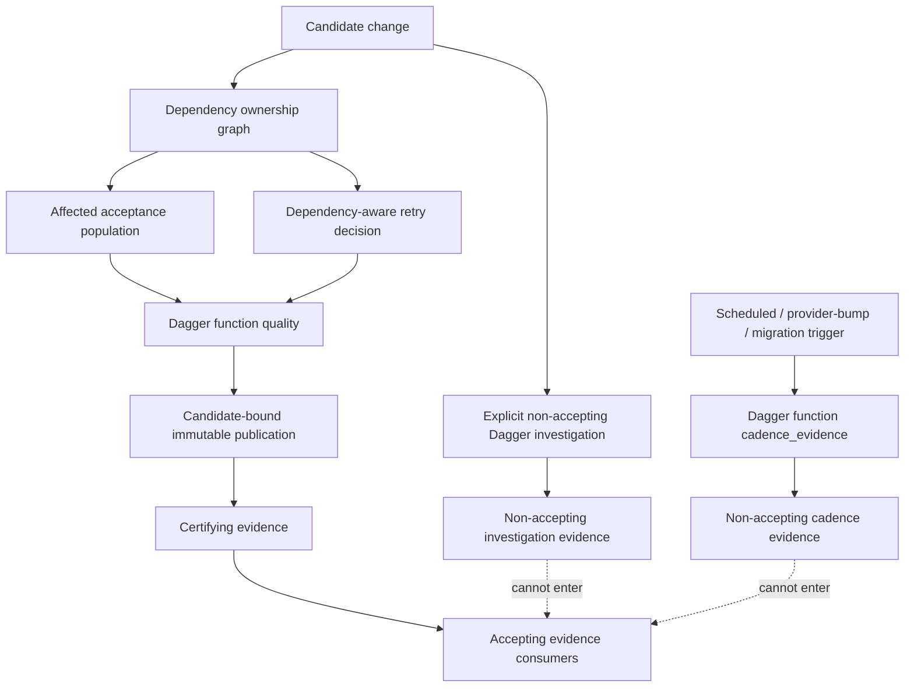

# Python Test Evidence System

This page is for a contributor. It states how this repository sorts its Python test evidence:
by what a result can prove, who owns its truth, how much execution fidelity it needs, when it
runs, and how long it stays.

Dagger is the sole Python acceptance authority. Only a passed Dagger certification yields the
evidence that an evidence consumer accepts ([Evidence altitude](#evidence-altitude)). Faster and
less frequent ways exist, but neither speed nor use of a Dagger container gives a result
acceptance authority.

Certification runs only when a contributor asks for it, and it commits nothing. No hook, no
closeout and no landing starts it: a closeout runs the knowledge gate and the repository's
pre-commit hook on the tree it publishes, and no test. A certification judges a candidate: the
tree of the checkout's `HEAD` with its staged changes.
[CONTRIBUTING.md](https://github.com/Foxfire1st/agents-remember/blob/main/CONTRIBUTING.md#certification)
gives the command.



## Evidence altitude

A certification is the run; certifying evidence is the result of a passed run; an evidence
consumer that calls `require_certifying_evidence` accepts only certifying evidence. There are two
outcomes for an evidence consumer:

| Altitude | Construction | Evidence consumers |
| --- | --- | --- |
| Diagnostic (non-accepting) | Explicit Dagger investigation, cadence and causal artifacts, each labelled `acceptanceEligible=false`. | Developer and agent diagnosis and review context only. |
| Certifying | A passed quality result published by the Dagger executor in an immutable generation bound to the exact candidate tree and result digest. | Every evidence consumer that calls `require_certifying_evidence`. |

`CertifyingTestEvidence` has no public constructor. An arbitrary non-certifying object or copied
artifact cannot satisfy an accepting evidence consumer. The nonce and file admission handshake
prevents an ordinary start of the tests in a wrong way: the Dagger module puts one random value
into the environment variable `AR_DAGGER_TEST_ATTESTATION` and the same value into a file of its
container, and the test support admits a process only when the two match. The handshake is not
treated as authentication against the owner of the repository and interpreter. The immutable
Dagger publication is the durable acceptance boundary.

No run on the host accepts. A failed or non-accepting Dagger run does not become acceptance
evidence, and no bypass flag changes evidence authority.

## Evidence lanes

`agents_remember_test_support.testing.evidence_lanes` is the closed registry of evidence
[lanes](https://github.com/Foxfire1st/agents-remember/blob/main/CONTRIBUTING.md#lanes) (the enum
`EvidenceCategory`).

| Lane | Default authority | Minimum fidelity | Normal trigger | Expected lifetime |
| --- | --- | --- | --- | --- |
| Unit regression | Owned product behavior | In-process | Affected, release | While the behavior is supported |
| Public contract | Supported port or wire contract | Public boundary | Affected, release | While the contract is supported |
| Integration | Real composition or local process boundary | Local composition | Affected, release | While the composition is supported |
| Architecture fitness | Repository architecture contract | Repository structure | Affected, release | While the architecture rule is active |
| Provider conformance | Independent recording or specification | Independent boundary | Affected, provider bump, release | Versioned to the provider/protocol |
| Stress/durability | Process, race, load, or historical-sensitivity contract | Process/race | Scheduled, release | While the durability contract is supported |
| Migration | Named temporary transition owner | Transition comparison | Affected, migration window, release | Until verified graduation or expiry |
| Diagnostic | Explicit non-accepting Dagger investigation | Controlled investigation | Explicit investigation invocation | Invocation-local only |

`mcp/tests/test-evidence-lanes.toml` assigns every test file to exactly one of the seven
accepting lanes. The eighth value of the enum, `diagnostic`, is non-accepting and holds no test
file. The loader also accepts an override for one class or one test node of a file that contains
mixed evidence. There is no unmarked-unit default: missing, conflicting,
stale, unknown, or provider-gate-inconsistent membership refuses collection. Pytest markers are
a checked projection of that manifest, not an alternate authority.

A run of the affected tests excludes sustained stress; the full release run runs the whole
population. Scheduled, provider-bump, and migration-window commands run in the pinned Dagger
environment but write explicitly non-accepting results. Release and investigation triggers are
not accepted by that cadence runner, so it cannot stand in for the Dagger function `quality`.

## Durable evidence lifecycle

`mcp/tests/evidence-lifecycle.toml` is the lifecycle catalog, the machine-readable inventory for
durable fixtures, recordings, recording generators, migration proofs, and shared support. Every
entry declares:

- path, kind, authority, owner, lane (field `category`), and minimum fidelity;
- cadence, source version or generator, and what introduced it;
- lifetime plus either a permanence rationale or an expiry date;
- an executable replacement contract; and
- every file that uses the artifact (field `consumers`). Test artifacts use `exact` or
  `all-tests`; support whose `consumers` are other source files and not test modules (the
  harness under `scripts/e2e_harness`, and one fixture model in the test tree) uses
  `exact-source`, which is checked against the same source-derived import and literal-reference
  graph.

The lifecycle catalog is validated in the Git hooks and in both Dagger quality modes. It fails on
an uncataloged governed artifact, an entry of `consumers` whose file does not exist, unknown
field, contradictory authority or lifetime, expired migration, nonexistent replacement node or
contract, or missing rationale.
`node:` replacement references are parsed and must name exactly one real top-level function or
class method; prose that merely resembles a selector is not sufficient.

Both catalogs are kept in one canonical form: contract rows ordered by `id`, artifact rows by `path`,
every list ascending without duplicates, one path per line in double quotes with a comma after it,
every table header at the start of its own line. Git merges them as unions of added lines
(`.gitattributes`). Both loaders refuse a catalog that is not in this form and name the command that
writes it:
`python -m agents_remember_test_support.testing.evidence_lifecycle --project-root . --write`.
The command needs `mcp/test_support` and `mcp/src` on `PYTHONPATH`.

The command makes no decision. It orders rows and lists, removes duplicate lines, and sets the
list `consumers` of each `exact` and `exact-source` row to the set derived from the source tree; a
row for which the source tree shows no file that uses it keeps its list as written and is named.
It removes each line of the lane manifest and each line of a list `consumers` whose file does not
exist, which a union merge can bring back, and prints it. It removes no row: a row whose own file
is gone is named, and a row whose list `consumers` would be left empty keeps its list as written.
It refuses what it cannot read or cannot keep, such as
a table header that is not at the start of its own line, a list whose key or closing bracket it does
not find, a comment inside a list or a row listed twice, and a refusal writes nothing to either catalog.
Without `--write` the same command is the validator: it loads the lifecycle catalog and then the
lane manifest.

No byte or count of a catalog is pinned. The loader checks what the source tree can prove: that every
contract's owner path and evidence node, and every row's replacement contract, names an existing
target, that no row or contract is unreferenced or missing, and that each list `consumers` equals
the derived set (for an `all-tests` row: every test module). The other descriptive fields of a row
(`kind`, `authority`, `category`, `fidelity`, `cadence`, `lifetime`, the `owner` label,
`introduced_by` and a retargeted contract) are checked only against the loader's rules for their
values; within those rules a change is data that a reviewer of a diff reads like any other line.

The validator prints the current number of governed artifacts. The fresh-user acceptance harness
under `scripts/e2e_harness` belongs to the permanent population.

## Fixture authority

One authority rule governs fixture design:

```text
internally owned shape -> canonical product model/builder + scenario-local override
external boundary truth -> independent recording/specification/version or deliberate malformed case
```

The rule does not require provider recordings to be regenerated from production adapters; that
would make conformance self-referential. Conversely, internally owned schemas should not be copied
into permanent hand-authored baseline universes.

## Quality obligations by surface

Static correctness and behavioral certification are deliberately not identical populations.

| Rail | Product Python | Ordinary tests | Shared test support | Durable fixtures |
| --- | :---: | :---: | :---: | :---: |
| Ruff / format | yes | yes | yes | n/a |
| Pyright | yes | yes | yes | n/a |
| File size | yes | yes | yes | n/a |
| Layering | package graph | import participation | import participation | n/a |
| Evidence lifecycle | when governed | when governed | yes | yes |
| Radon report | changed/measured product only | no | no | no |
| [CRAP score](https://github.com/Foxfire1st/agents-remember/blob/main/CONTRIBUTING.md#what-fails-a-change-and-what-only-reports) | measured product functions only | no | no | no |
| Changed statement/branch coverage | changed product units only | no | no | no |
| Pytest | affected or release population | executes | executes through the tests that use it | executes through the tests that use it |

Test and support code therefore remain linted, formatted, typed, size-bounded, and directly tested
where they own risky logic. A branch added to test support creates no production CRAP or
changed-coverage obligation that would demand another test solely to certify the testing
machinery.

Coverage is diagnostic: no percentage is required, and an uncovered line demands no test. CRAP
is computed for production functions only. Its threshold of 20 prompts review and does not block
delivery. The Radon reports fail nothing.

## Dependency-owned selection

`DependencyOwnershipGraph` is the single owner used by targeted selection, retry proof, and causal
preflight. It records why each test was selected:

- the test imports a changed module, directly or through other modules;
- the lifecycle catalog lists the test in `consumers` of a changed artifact;
- exact changed test;
- narrow name or text heuristic;
- global pytest input; or
- explicit irrelevant classification.

The graph treats root pytest configuration and `conftest.py` as global. A changed support module
selects the tests that the lifecycle catalog lists in its `consumers` and the tests that import
it. A governed recording or fixture selects the tests in its `consumers`. An ordinary test
selects itself. A deleted test is explicitly removed from the population.
Unowned executable or support input, parse errors, ambiguous module identity, and invalid lifecycle
metadata publish every unresolved path as `test-selection-ownership-incomplete` and stop before
[Gate 2](../reference/repository-certification-profile.md#gate-meanings), the certification gate
of the ordinary test suites; they never broaden to a safe-full population. Documentation and
dashboard inputs remain visible and explicitly irrelevant to the Python suite while their own
repository-profile rails retain their declared populations.

The [repository selector](../reference/repository-certification-profile.md#selector) writes its
result as a document of the schema `repository-selector-result/v2`. The result binds the exact
candidate, selector identity, version and configuration, mode and base revision to the empty,
targeted, or profile-approved full population; every output value has a source-backed dependency
reason. The independent Dagger reader verifies that digest and identity before any command of
Gate 2. The schema is language-neutral; Python ownership is only this repository's provider
implementation.

Broad fan-out is not automatically a false positive. A central model that many test modules
import has that many real transitive ownership edges. The report lists those edges apart from
supplementary text-reference reasons and does not call the whole population heuristic.

## Dependency-aware retry proof

Retry is an internal Dagger optimization after a passed pytest run and a later execution
failure. Its schema binds repository bytes, selected tests, the immutable selector-result digest,
diff base, Python and tool versions, environment digest, measurement settings, and the exact
included and excluded lane population. Proof lives only in the folder that
`AR_QUALITY_RETRY_CACHE` names, where the Dagger module mounts the cache volume
`ar-quality-retry-v3` of the engine with the sharing mode `LOCKED`; the engine keeps the volume
from one run to the next, and no other place is read.

| Candidate change after a proof | Retry decision |
| --- | --- |
| No change | Reuse exact proof; pytest does not restart. |
| Completely owned, no affected selected test | Reuse exact proof. |
| Completely owned ordinary test/support/fixture change | Retain unaffected test contexts outside pytest-cov, rerun affected selected tests into clean coverage data, then explicitly merge and regenerate the scored JSON report. |
| A test that uses the change lies outside the current selection | Run the current admitted population fresh. |
| Global input | Run the current admitted population fresh with the exact ownership reason. |
| Incomplete/ambiguous ownership | Refuse in Gate 1 before retry or pytest. |
| Selection/config/environment/lane drift | Run the current admitted population fresh with the mismatched manifest fields. |
| Missing, malformed, corrupt, or digest-mismatched proof | Run the current admitted population fresh with the exact cache-integrity reason. |

The retry path never chains a filtered proof as a new baseline. A passing wrapper deletes the
proof; only a fresh full pytest pass followed by a later rail failure may publish one. The
Dagger function `quality` leaves retry enabled. `AR_QUALITY_NO_RETRY=1` is the one explicit
rollback switch: it preserves the cache for diagnosis and runs the full fresh population.
Non-accepting investigation runs cannot read or publish retry authority outside their
invocation-owned proof.

## Causal failure localization

The Dagger function `quality` validates high-fanout prerequisites once at their owner before
pytest. A failed
preflight writes one stable causal identity. Source-derived module/symbol imports plus the executed
helper/fixture call chain may prove exact dependent nodes; reverse importers of the observer are
not causal edges. Incomplete ownership never produces blanket suppression.

Pytest still executes independent evidence. The resulting JSON and Markdown artifacts contain the
first causal failure, corrective owner, dependency chains, blocked nodes, and independent
failures. Process-, socket-, async-, or multiprocessing-sensitive failures keep their exact node,
seed, worker, timing, and process-family reproduction semantics. The causal artifact is always
`acceptanceEligible=false`; a preflight failure still fails the run of the Dagger function
`quality` even when dependent symptoms are skipped.

## Supported commands and cadence

| Intent | Command owner | Authority |
| --- | --- | --- |
| Requested certification of a change | The [clean-room command](https://github.com/Foxfire1st/agents-remember/blob/main/CONTRIBUTING.md#certification) with `--mode targeted`, which calls Dagger `quality` with an admitted targeted profile plan | Certifying when the exact publication passes |
| Requested certification of the whole repository | The clean-room command with `--mode full`, which calls Dagger `quality` with an admitted full profile plan | Sole whole-system Python acceptance |
| Scheduled stress | Dagger `cadence-evidence --trigger=scheduled` | Non-accepting cadence evidence |
| Provider refresh | Dagger `cadence-evidence --trigger=provider-bump` | Non-accepting cadence evidence |
| Migration window | Dagger `cadence-evidence --trigger=migration-window` | Non-accepting cadence evidence or loud not-applicable result |
| Targeted Vitest | `npm --prefix dashboard test -- <files>` | Diagnostic only |

The clean-room command is `python -m agents_remember_test_support.code_quality.clean_room`.
Ordinary isolated host pytest is supported for development as described in
[Python test policy and commands](python-pytest-bootstrap.md). The quality wrapper and the
certifying bootstrap keep their Dagger admission boundary: both refuse outside the Dagger run.
Host results do not substitute themselves for certification.

## Maintenance rules

1. Add durable evidence only with complete lifecycle metadata and an executable replacement.
2. Prefer canonical builders for internal truth and independent recordings/specifications for
   external truth.
3. Add ownership edges to the lifecycle catalog or real imports; do not add a second selector map.
4. Treat every fresh/full decision as an explicit conservative result with a stable cause, never
   as a silent fallback.
5. Keep stress out of affected repair runs without deleting deterministic durability regressions.
6. Follow the case budgets and behavior-based admission policy in
   [Python test policy and commands](python-pytest-bootstrap.md); diagnostic coverage and
   production CRAP findings do not require suite growth.
7. Advice: ask for a `full` certification run once, on the complete candidate.

The admission and bootstrap contract stands in
[Python test policy and commands](python-pytest-bootstrap.md), the contract of the accepting
evidence consumers in
[Python Test Evidence Authority](python-test-evidence.md).
