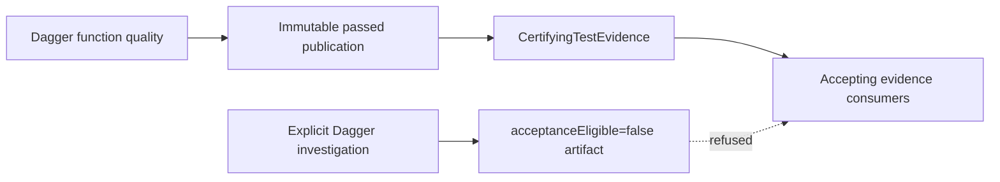

# Python Test Evidence Authority

This page is for a contributor. It states which test result counts as acceptance in this
repository and which code enforces that.

Python acceptance has one authority: the passed result of a run of the pinned Dagger function
`quality`. The run publishes the result in an immutable generation of reports, whose manifest
binds it to the candidate, the tree of the checkout's `HEAD` with its staged changes. Investigation
routes may publish explicitly
[non-accepting](python-evidence-system.md#evidence-altitude) artifacts, marked
`acceptanceEligible=false`, but those artifacts cannot satisfy an accepting evidence consumer.

Certification runs only when a contributor asks for it, and it commits nothing. No hook, no
closeout and no landing starts it: a closeout runs the knowledge gate and the repository's
pre-commit hook on the tree it publishes, and no test.
[CONTRIBUTING.md](https://github.com/Foxfire1st/agents-remember/blob/main/CONTRIBUTING.md#certification)
gives the command.

The product's assertions run in the ordinary isolated pytest suite described in
[Python test policy and commands](python-pytest-bootstrap.md). That development loop has no
certification authority.

## Evidence consumers

`EvidenceConsumer` in `mcp/src/agents_remember/models/test_evidence.py` names the evidence
consumers of a test result: `local-feedback`, `coverage`, `quality`, `retry`, `route-review`,
`lifecycle`, `closeout` and `integration`. `require_certifying_evidence` in the same module
refuses, for every evidence consumer except `local-feedback`, anything that is not a
`CertifyingTestEvidence`.

`DaggerAdmission` is an object that the test support creates only inside a run of the Dagger
module, after the nonce and file handshake that
[Evidence altitude](python-evidence-system.md#evidence-altitude) describes; outside that run the
test support refuses it. These functions enforce the boundary:

| Evidence consumer | Owner | Required evidence |
| --- | --- | --- |
| Delivery coverage publication | `agents_remember_test_support.code_quality.quality_plan._pytest_step` | the `DaggerAdmission` capability; metric values are diagnostic |
| Quality | `agents_remember.worktrees.modules.quality.clean_executor.run_clean_quality` | mints certifying evidence only from a passed publication |
| Retry | `agents_remember_test_support.code_quality.retry_proof.prepare` | the `DaggerAdmission` capability; explicit locked Dagger cache |
| [Route review](../concepts.md#route-review) | `agents_remember.worktrees.route_review_scope.require_current_route_review` | current review at its owning altitude; atomic children defer to the accumulated master integration review; no test substitution |
| Lifecycle | `agents_remember.worktrees.modules.quality.gate.run_strict_code_quality_gate` | certifying only |
| Closeout | `agents_remember.worktrees.queue.closeout_staged_quality.gate_staged_code` | certifying only |

`gate_staged_code`, the owner of the row Closeout, is the only caller of
`run_strict_code_quality_gate`, the owner of the row Lifecycle, and no closeout or landing route
of the product calls `gate_staged_code`. A closeout and a landing therefore consume no test
evidence. No function of the product asks for the evidence consumer `integration`.

`CertifyingTestEvidence` has no public constructor. The Dagger executor mints it only after a
successful result is published in an immutable generation whose manifest binds the exact
candidate tree and result digest. Recovery revalidates that same generation, passed result, and
candidate binding before minting the capability again.

Certifying coverage and retry publications require the opaque `DaggerAdmission` capability.
Ordinary development coverage remains diagnostic and cannot be promoted into that authority.
Route review remains an independent plane-stamped verdict and exposes no test-evidence input. An
arbitrary object, copied non-accepting JSON, renamed file, zero exit code, failed Dagger result, or
manifest for another candidate has no authority.

## What a passed run decides

A passed certification run means that every enforcing rail of the selected profile passed on
the exact candidate: lint, formatting, typing, structural rules and the tests. Coverage and the
[CRAP score](https://github.com/Foxfire1st/agents-remember/blob/main/CONTRIBUTING.md#what-fails-a-change-and-what-only-reports)
are reported and decide nothing. The CRAP threshold of 20 prompts review of a
production function and does not block delivery.

## Non-accepting investigation contract

Cadence runs, the causal failure report and the diagnostic investigation execute in Dagger but
remain review and diagnostic evidence. Each artifact declares `acceptanceEligible=false` and has
no publication path to `CertifyingTestEvidence`.

Using Dagger is necessary for hermeticity but not sufficient for acceptance. Only the quality
function's verified immutable publication can cross the accepting boundary.
