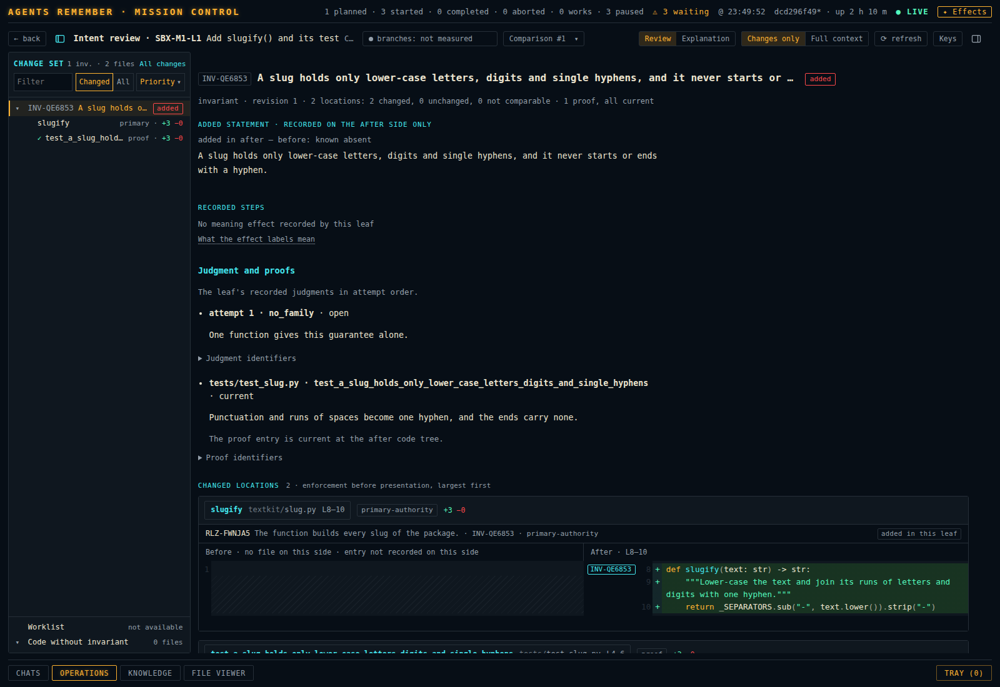
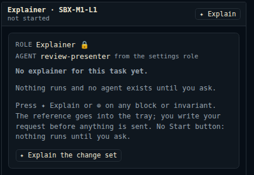

# The review page and the explainer

The review page shows the change of one task: its code and its memory before and after, and the
knowledge records that the change reaches. You read there what the task changed and what
the Curator of the task recorded about the change. The Curator records it in
[judgment rows](../concepts.md#judgment-row): the rows of a history file in the memory.

The page has one optional helper, the explainer. The explainer is an agent that reads the change
set and writes an explanation page for you. A task has at most one explainer, and it
starts only when you send it a request.

[Concepts](../concepts.md) defines the terms task, comparison, explainer, revision, grade and
tray. [The Dashboard](../dashboard.md) describes the pages around the review page.

## Open the review page

The button "⇄ Intent review" on the page of a task opens the review page. A task that has a code
worktree or a memory worktree shows the button as "⇄ Intent review". A task without one shows it
as "⇄ Intent review (recorded)".

The button carries counts of the task's change.

| Text on the button | Meaning |
| --- | --- |
| "+N −N" | Revisions of invariants and family guarantees that only the after side holds, and those that only the before side holds. A [family](../concepts.md#family) is a record that groups invariants; its guarantee is the statement of what its members keep together. The numbers count no lines. |
| "· K without an invariant" | K changed files hold a change that no knowledge record covers. |
| "· K without an invariant · N unknown" | In addition, the product could not attribute the change of N files. |
| "· attribution partial" | The product measured a part of the change set only. |
| "· attribution unknown" | The product could not measure the change set. |
| "· N open" or "· all answered" | N worklist items about changes without an invariant are open, or each of them is answered. |
| "unavailable", "no knowledge yet", "offline", "unreadable" or "not found" | The counts could not be read, and the word stands in their place. The "?" beside the button opens the code and the reason. The button of a task that has not started reads "⇄ Intent review (recorded) unavailable". |

"← back" or Escape closes the review page and returns to the task document.

### The address

The review page has an address of its own:
`#review?repo=<repository>&master=<master folder>&leaf=<task id>`. The key `leaf` takes the id of
the [task](../concepts.md#task); the review page says "leaf" for a task in some of its texts. The
addition `history=recorded` opens the recorded review of a task without a worktree.

The page keeps the address current while you read. It adds `sel` for the selected row
and `comparison` for the number of the comparison on screen. Each selection is an entry of the
browser history. The browser's Back returns to the previous selection, and from the first
selection it closes the review page.

### The comparison

A comparison is one recorded pair of states of the task in both repositories: the code before and
after, and the memory before and after. Each recorded comparison has a number, and the page names
it "Comparison #n".

The selector "Comparison #k ▾" in the top line opens the list "Comparisons of <task>". Its rows
read "delivered", "latest" or "read-only". The list says "Choosing an older number shows that
comparison read-only." For an older number the page then reads "Comparison #k is shown read-only;
statements and judgments are read on comparison #n." and offers "Show #n". The "⊕" of the selector
adds the whole change set to [the tray](#the-tray), which collects what you send to a chat.

A task that has landed and has no worktree opens on the comparison it delivered. Earlier
comparisons of that task stay in the list. When the comparison on screen is another one, the page
says so and offers "Open the delivered comparison #n".

A task that has not started has no worktree and no comparison. Its review page reads "the review
unavailable", where "the review" names what the page could not open: the review of the task. See
[The intent review before work starts](#the-intent-review-before-work-starts).

## The layout



The page has three columns. The tree on the left lists what changed, one line per row. The reading
column in the middle shows the texts, the code and the records of the selected row. The
[chat sidebar](../concepts.md#chat-sidebar) on the right holds the chat of the task's explainer.

The picture also shows the top bar of the dashboard, which stays above the review page. Its switch
"✦ Effects" belongs to the dashboard; [The top bar](../dashboard.md#the-top-bar) describes it.

The chat sidebar is closed each time the review page opens. In a window narrower than 1440 px the
open chat sidebar lies over the reading column.

### The top line

| Part | What it does |
| --- | --- |
| "← back" | Closes the review page. |
| Tree toggle | Shows and hides the tree. |
| "Intent review · <task id>" and the title | Name the task. |
| "Change set · comparison #N" | Names what the reading column shows. |
| Status chip | Says whether the task's branches moved after the comparison was recorded. It reads "branches: current", "branches: moved", "comparison: stale", "branches: unavailable", "branches: not measured", "reading…" or "unavailable". A press lists "Sync movement", "External Git movement", "Subject staleness" and "Bound comparison". |
| "Review" \| "Explanation" | Two tabs. They choose what the reading column shows: the change set or the explainer's page. The page opens on "Review". |
| "Comparison #k ▾" | Selects the comparison. |
| "Changes only" \| "Full context" | Sets how much code a card shows. "Changes only" folds each unchanged stretch and keeps three lines around a change; a folded stretch reads "N unchanged lines" and opens on a press. "Full context" shows the whole recorded range. The browser keeps the choice. The control is disabled on the tab "Explanation". |
| Refresh | Reads the comparison again, against the task as it is at that moment. |
| "Keys" | Lists the keys of the page. |
| Chat toggle | Shows and hides the chat sidebar. |

### Keys

| Key | What it does |
| --- | --- |
| `[` | Shows and hides the tree ("Tree sidebar"). |
| `]` | Shows and hides the chat sidebar ("Chat sidebar"). |
| `j` | "Next block": selects the next changed block of the reading column. |
| `k` | "Previous block": selects the previous changed block. |
| `?` | Opens "Reviewer keys", the same list as the button "Keys". |

`j` and `k` walk every changed block of the task, a change of meaning and a change of code alike.
A change of meaning is a change of what a record states: the statement of an invariant or the
guarantee of a family differs between the two sides.
At the last block the page says "No later block; the selection stays.", and at the first block "No
earlier block; the selection stays." The tree keeps every family the walk passed, so `k` steps
back to each block you came from. The keys do nothing while the cursor is in a text field. A
user can bind `j` and `k` to other keys; `[`, `]` and `?` are fixed.

## Read the change set

### The tree

The tree has the heading "Change set" with the counts "N inv. · N files". The link "All changes"
beside it opens every changed file.

Above the rows stand three controls. "Filter" narrows the rows by text. "Changed" | "All" shows
the changed rows only or every row. "Sort: <name> ▾" orders the rows.

A row is one family or one invariant. Its right side gives the reason it is in the review: a
change badge, or the effect the Curator recorded with the number of code locations. A family that
you walked past stays in the tree with the tag "kept"; its hover text reads "Kept; last read for
<subject>". Invariants that belong to no family stand under "Without a family".

The tree also says how many invariants changed in their code only, for example "2 invariants
changed only in their code." Each of them has a row with the badge "code changed", so `j` reaches
it.

Two rows are pinned at the bottom of the tree. "Worklist" opens the worklist of the task and
reads "N open" or "all answered". "Code without invariant" lists the changed files that no
knowledge record covers and reads "N files".

The row "Worklist" counts every item of the worklist. The button "⇄ Intent review" counts only the
items about changes without an invariant. The two can differ: the button reads "· all answered"
while the row reads "2 open". When the page cannot count the items, the row reads "not available".

The page reads the detail of a row when you select it. The dashboard's server reuses the
answer of a recorded comparison only while every file and Git object behind that answer is
unchanged.

### Sorts

The menu "Sort: <name> ▾" has three groups.

| Group | Sort | Order |
| --- | --- | --- |
| "Always available" | "Priority" | The recorded effect first, then the change badge, then the size of the change. |
| | "Authored" | The order the Curator wrote. |
| | "Memory currentness" | The least current first. |
| "Memory facts at the location" | "Most invariants on the location" | By the invariants recorded at the path of the location. |
| | "Most incoming links" | By the links into the invariant of the location. |
| | "Invariants without proof first" | Invariants that the index lists without a proof first. |
| | "Most open weaknesses" | By the open weaknesses recorded at the path of the location. |
| "Explainer’s judgment" | "✦ <category>" | The highest grade first, then the order of "Priority". One sort for each category the explainer defined. |

"Priority" is the sort the page opens with. It puts the rows with the effect `retire`, `weaken` or
`replace` first, then the other effects with `clarify` last, then the rows without an effect.
Among equal effects the badge decides: "removed", "changed", "added", "code changed", then the
rest.

The browser keeps the chosen sort. When a sort cannot be computed the page says "<sort> is
unavailable: <reason>; Priority applies."

### Change badges

A change badge says what differs between the two sides of the comparison. Agents Remember computes
it from the records and the trees; no agent writes it.

A tree row carries one of these badges.

| Badge | Meaning |
| --- | --- |
| "added" | Only the after side holds this record. |
| "removed" | Only the before side holds this record, or the after side retired it. |
| "changed" | Its revision or authored text differs between the two sides. |
| "code changed" | A recorded implementation entry or a hunk within its range changed. A hunk is one stretch of changed lines in the diff of a file. |
| "joined" | This family lists the invariant on the after side only. |
| "left" | This family lists the invariant on the before side only. |
| "unknown" | A change fact could not be read or established. |
| "unchanged" | The record is unchanged. The badge does not say that its code is unchanged. |

A family whose own record is unchanged and whose members changed reads "N changed".

In the reading column each member row of a family carries the kind of its change.

| Kind | Meaning |
| --- | --- |
| "intent" | The revision of the invariant differs between the sides, the invariant was added or removed, or its text differs. |
| "impl" | The revision is unchanged; an entry changed, or a changed hunk meets its range. |
| "membership" | The family's record lists the invariant on one side only. |
| "unknown" | A fact could not be established, so the member is not known to be unchanged. |
| "unchanged" | Revision, membership and code facts are all established as unchanged. |

A member row can also carry the marks "same revision; text differs" and "+test". The family's
own line reads "guarantee" with the kind of its change, and "Members by change: …" counts the
members by kind.

### Recorded effects

Where a task changed the meaning of an invariant or the guarantee of a family, its Curator records
an effect in the judgment row of that change: one word that says what the change does to the
obligation. The tree row shows the effects in the order of the attempts, joined by " → ".

The reading column shows them under "Recorded steps", one step for each attempt: "attempt N ·
revision N · <effect> · <row id>". Each step says "history file closed" or "history file still
open", and "Row record" opens the raw row. With more than one step the page says "These are the
leaf's successive recorded judgments." The page shows the steps in their order and computes no
net effect from them.

"What the effect labels mean" lists the nine effects.

| Effect | The page's sentence |
| --- | --- |
| `restore` | brings back an obligation that had been dropped or broken. |
| `clarify` | rewords the obligation; what it requires stays the same. |
| `introduce` | states an obligation that was not recorded before. |
| `strengthen` | adds to the obligation or tightens it. |
| `weaken` | relaxes the obligation or removes part of it. |
| `replace` | puts a different obligation in its place. |
| `split` | divides one obligation into several records. |
| `merge` | joins several records into one obligation. |
| `retire` | ends the obligation. |

A sentence explains the label. It does not say whether the Curator's judgment is right. A row
that holds no effect reads "effect not recorded". A record without any step reads "No meaning
effect recorded by this leaf".

### The reading column

The review page opens with no row selected. The reading column starts with one summary line: "N
invariants changed" with the recorded effects, "N changed locations in N files", "N files without
invariant", "N unchanged or not comparable, folded" and "sorted: <sort>". Under it stand the
families and their members in short form, without code, and the line "Select a family for its
overview or an invariant for its code and changes." The page does not move under you while it
reads: the reading column scrolls once, to the row you selected, when that row has been read.

For a selected invariant the reading column shows these parts.

- **The wording.** When the wording differs, the page shows each changed text as one passage with
  removed words struck and added words underlined. "Inline" | "Side by side" sets the form, and
  the browser keeps the choice. A rewrite of more than half the words opens side by side. When the
  wording is the same the page says "Wording unchanged".
- **"Recorded steps".** See [Recorded effects](#recorded-effects).
- **The cards.** Each code or test location of the invariant is one card. Above the cards stands
  "Changed locations N · enforcement before presentation, largest first": the number of changed
  locations and the order of the cards. With another sort than "Priority" the line ends "sorted by
  <sort>". The card names the file and the range on each side and shows the authored rationale of
  the entry directly above the excerpt. A changed range appears as its diff, an unchanged range
  once. A card can carry the badge "Unchanged" or "Not comparable". A diff stands side by side
  where the reading column is at least 1,080 px wide inside its padding, and in one column where
  it is narrower.
- **The folded locations.** The locations whose recorded code is the same on both sides stand in
  the closed group "N unchanged location(s)". Those with a side that is absent, unresolved or
  unreadable stand in the closed group "N not comparable". An opened group shows one line for each
  location, the first four of them, then "… N more, one line each".
- **"Statement, membership and realization details".** A list of facts about the record: the
  guarantee of its family, the revisions of its statement before and after, its membership rows
  and the code locations recorded for it.
- **"Judgment and proofs".** The judgment rows of the task about the record, in the order of the
  [attempts](../concepts.md#attempt). A row reads "attempt N · <disposition> · closed" or "… ·
  open"; a row that holds an effect names it before "closed" or "open". The disposition is the
  Curator's word for what the task did to the record: `changed`, `moved`, `deleted`, `extended`
  or `no_impact` for an invariant, `changed`, `rerouted`, `assigned`, `retired` or `no_impact`
  for a family, and `no_family` for an invariant that the Curator found to belong to no family.
  The reason of the row stands on the line under it. "Because: …" follows only when the row names
  the decisions or the requirements it rests on. The proofs of the record follow, each with its
  state at the code after the change. "Judgment identifiers" and "Proof identifiers" open the raw
  identifiers.
- **"Worklist items about this record".** The worklist items of the task that name the record.
- **"Technical details · raw records of comparison #n".** The raw identifiers: "Entry
  identifiers", "Selected subject's provenance", "Task and subject identifiers" and the two trees
  of each repository.

For a selected family the reading column shows the guarantee, with the same word diff, and the
members. The roster line of the family says how much of the family was read. It includes "N
anchor(s) not at their recorded blob" when N anchors were not read at the blob their record names.
An [anchor](../concepts.md#anchor) records one place in a file together with the Git blob of the
file; a blob is the object in which Git stores the content of one file.

### Marks in a diff

In a diff each changed hunk carries a mark in the gutter, the margin of the diff that holds the
line numbers. The mark names the invariants whose recorded ranges meet the changed lines, or it
reads "unexplained" or "attribution unknown". A press on a named invariant selects that invariant
in the tree. The top line then offers "← Back to <file name>", which returns to the hunk.

### Code without an invariant, and the worklist

The row "Code without invariant" lists each changed file that holds a change no knowledge record
covers. A file row reads "<n> of <m> hunks unexplained", "<n> of <m> hunks unknown" or "non-text".
"Unexplained" means that no record covers the lines. "Unknown" means that the product could not
attribute them.

The row "Worklist" opens the view "Worklist" with one line for each item. Each item says where it
stands: "answered by <witness>", "open: <reason>", "undecided: <reason>", or "state not measured
for this comparison". An open item whose subject has a judgment row reads "row <row id> is stale:
<reason>" in place of "open: <reason>". The knowledge gate decides these states; the page only
shows them. [Knowledge System](../reference/knowledge-system.md) describes the worklist and the
knowledge gate.

The same view lists "Changes without an invariant · N items". It also says "Changed knowledge
files are read in the change-set viewer." and offers "Open changed knowledge files".

### When the page cannot show something

The page says in a sentence why a thing is missing.

- Beside the badge "unknown": "No entry covers these lines yet; curation attaches them to an
  invariant or records that none applies."
- For list items of a text that it cannot match: "These items could not be paired one to one; they
  are shown as removed and added."
- While the gutter marks are read: "intent marks loading…".
- For an invariant that a gutter mark opened and whose family membership could not be read:
  "Attribution unknown", "opened from an intent marker" and the reason.

## Open exact evidence and come back

The page reads each file at an exact Git tree of the comparison and each record at an exact
revision. It offers these ways from a statement to its evidence, and each has a way back.
A claim, in the last row of the table, is one statement of the explainer's page together with
the places of the comparison that it rests on.

| From | Opens | Back |
| --- | --- | --- |
| "All changes" in the tree | The change-set page over the review page, on the trees of the comparison, with every changed file. | "← Back to intent review" or Escape. |
| "Full page ↗" on "Code without invariant" | The change-set page with the filter of that row. With files of both kinds the links read "Unexplained ↗" and "Unknown attribution ↗". | "← Back to intent review" or Escape. |
| "Open changed knowledge files" in the worklist | The change-set page, where a changed knowledge file is read like any changed file. | "← Back to intent review" or Escape. |
| A mark in the gutter of a diff | The invariant in the tree. | "← Back to <file name>". |
| "Technical details" | The raw records of the comparison, at the bottom of the reading column. | Close the disclosure. |
| A claim in the explainer's page | The tab "Review" with the place of the evidence selected, when the evidence resolves in the comparison on screen. Otherwise nothing opens. | The tab "Explanation". |

The change-set page has the filters "All (n)", "Changes without an invariant (n)" and "Unknown
attribution (n)". On return the review page is as you left it, and the keyboard focus is on
the control that opened the change-set page. When the changed files cannot be read the page says
"All changes unavailable".

A press on a claim of the explainer's page opens its evidence only when the evidence resolves in
the comparison on screen. When it does not resolve there, the press opens nothing and the page
shows no message. In two checks of this guide on a sandbox, each on a page that the explainer had
published for the comparison on screen, four claims were pressed and none opened its evidence.

## Badges, recorded effects and the explainer's grades

A row of the tree can carry statements of two origins; keep them apart when you read.
Badges and recorded effects come from the product and from the records of the task.
Grades are the assessment of the explainer.

| Statement | Who makes it | What it is |
| --- | --- | --- |
| A change badge | Agents Remember, from the two sides of the comparison | A computed fact. |
| A recorded effect, a judgment row | The Curator of the task | A record in the memory of the task. |
| A grade, marked "✦" | The explainer, when you ask for it | The explainer's inference. It is no record of the memory. |

The words of a grade never enter a change badge or an effect. The page marks every grade with "✦",
and the hover text of a grade starts with "Explainer's judgment (presenter inference):".
In that text "presenter" is the product's own word for the explainer, as in the name
`review-presenter` of its settings row.
[Grades](#grades) describes how you ask for them.

## The tray

The tray, which the button "Tray (n)" opens under the head "AR tray", collects what you want to
send to a chat. [The Dashboard](../dashboard.md) describes the tray in full. On the review page it
works like this.

- "⊕" on an invariant, a family, a block, a file of "Code without invariant" or the comparison
  selector adds a reference. The "⊕" then reads "✓ in tray".
- Highlighted text gets the offer "⊕ add". Ctrl+V adds a screenshot from the clipboard.
- Each pick takes a note with "+ note", or one of the quick notes "explain", "challenge this" and
  "is this a bug?".
- The line "to: … ▾" opens "Send the tray to", the list of live chats. The explainer's chat is the
  default while the chat sidebar shows it.
- Nothing leaves the tray before you press "Send".

A reference is no copy of the text. The receiving agent opens it with the tools of Agents
Remember, so every chat reads the same thing. The tray then reports "Delivered to …", "Held for …"
or "Refused by …". After a refusal the picks and the text stay in the tray.

## Ask the explainer



The chat toggle or `]` opens the chat sidebar. Its header reads "Explainer · <task>" with one of
these states.

| State | Meaning |
| --- | --- |
| "not started" | The task has no explainer. |
| "new request · not sent" | The first-request form is open. |
| "starting" | The explainer's workspace is being built. |
| "live · idle" | The host reports the explainer as live. The state reads the same while a turn of the explainer runs. |
| "closed · resumes when shown" | The explainer exists and its process is closed. The [host](../concepts.md#host) resumes it when the chat sidebar shows it; that starts no model turn. |

The state is the report of the dashboard's server. It does not say whether the
[chat frame](../concepts.md#chat-frame) under the header shows the explainer's chat: when the
frame cannot show the chat, the frame says so in a notice of its own.
[When the host or a chat is missing](../dashboard.md#when-the-host-or-a-chat-is-missing) lists
these notices.

A task without an explainer shows a card: "Role" "Explainer 🔒", "Agent" "review-presenter" "from
the settings role", then "No explainer for this task yet." and "Nothing runs and no agent exists
until you ask."
Under these lines the card says "Press ✦ Explain or ⊕ on any block or invariant. The reference
goes into the tray; you write your request before anything is sent. No Start button: nothing runs
until you ask." The page has no start button.

The menu "▾" in the header lists the other live chats of the task. Without one it says "No chat of
this task is live."

### The first request

Three controls open the first-request form while the task has no explainer: "✦ Explain" in the
header, "✦ Explain the change set" on the card and on the empty tab "Explanation", and the first
"⊕" that puts a pick into the empty tray. That "⊕" also opens the chat sidebar, and the form
holds the pick. When the tray holds picks that are aimed at an archived explainer, the card also
offers "Send to the explainer · <task>", which opens the form with the picks of the tray.

The page reads the state of the explainer only when the chat sidebar is shown. Before the sidebar
has been shown once, the first "⊕" opens the first-request form also for a task that has an
explainer: the header reads "new request · not sent" and the target reads "to: a new explainer
for <task>". Open the chat sidebar before the first "⊕": the "⊕" then reads "✓ in tray", and the
target of the tray is "Explainer · <task>".

The form has these parts.

- "Role capsule · included, with the first request only 🔒". The
  [role capsule](../concepts.md#role-capsule) is the instruction text of the explainer. It goes out
  with the first request and with no later one. The lock marks a part of the form that is fixed:
  you cannot change it.
- The references. Each has "+ note" and "×". More presses on "⊕" add references to the open form.
  Without one the form says "No references yet. Press ⊕ on a block or an invariant; more ⊕ clicks
  add references to this form."
- The text box "What do you want explained? Leave it empty for the end-to-end review." An empty
  box asks the explainer for one review of the whole comparison on screen.
- The target "to: a new explainer for <task>". It is fixed.
- A summary of the message, for example "One message: the end-to-end review of the comparison on
  screen."
- "Cancel" and "Send". "Cancel" removes the picks from the tray and clears the text.

Under the form the page says what the press does: "Nothing is sent until you press Send. Sending
builds the explainer’s workspace for the comparison on screen, then delivers this as its first
turn." When the task already has an explainer's workspace, the line names the comparison that the
workspace is bound to, "#n", in place of "the comparison on screen".

### What "Send" builds

"Send" builds the explainer's workspace and then starts one explainer in the host. The request
is the first turn of that explainer.

The workspace is a folder of the explainer's own,
`<coordination-root>/explainer/<repository>/<master folder>/<task id>/`. The explainer works in it
with the tools of its harness. It holds:

- two detached Git worktrees, one of the code and one of the memory, at the after side of the
  comparison;
- the evidence that Agents Remember prepared for that comparison;
- the explainer's instructions and the [presentation kit](../concepts.md#presentation-kit), the
  set of libraries that a page of the explainer may load;
- the reference files of the task;
- the revisions, a draft and a scratch folder.

The explainer writes the claims of its page into the file `drafts/assets/claim-map.json`, the
claim map. The claim map lists each claim with its id, its statement and the bases it rests on,
such as a file in a tree of the comparison, a knowledge record or a judgment row. The product
reads the claim map when the explainer publishes. Each time the explainer checks its draft, the
report and the pictures of that check go into a folder `renders/run-NNN/`.

The workspace is bound to the comparison it was built for: its worktrees and its evidence are
those of that comparison. That comparison is the binding of the
[explainer](../concepts.md#explainer), and the page writes the binding as "#n", the number of the
comparison. A later "Send" reaches the same explainer and does not bind it to another comparison.

During the build the chat sidebar shows the box "Building the explainer’s environment" with a
percentage (the box calls the workspace the environment) and one line for each step, marked done,
running, waiting or failed. Under it the page says "Your request waits until the explainer is
ready, then goes out as its first turn: …". The tab "Explanation" carries the mark "◌" while the
build runs. The build box on the tab "Explanation" offers "Cancel the build".

A failed build names its step and gives the reason in the server's words: "<step> failed:
<reason>. Your request stays here for a new Send." The form keeps the request and says "<step>
failed: <reason>. Your request is kept; press Send again when it can run."

When the explainer cannot take its first turn at once, for example because it waits at a
permission prompt, the turn is [held](../concepts.md#held) for it in the host's queue. The page
then says "First turn held (<reason>): <detail>." When the state of the explainer cannot be read,
the page says "The explainer’s state could not be read: <detail>. The review stays usable." and
offers "Retry".

### What the explainer needs before it can publish

The explainer publishes a page only after a browser on your machine has loaded its draft. The
load needs three things that an installation of Agents Remember does not bring:

- the program `node` on the search path;
- the Playwright module. The dashboard's server reads the path of the module's file `index.js`
  from the environment variable `AR_PLAYWRIGHT` when it starts the explainer. Without the variable
  it looks for `dashboard/node_modules/playwright/index.js` in a checkout of the repository; an
  installation from the package has no such folder;
- the browser that Playwright installs, in Playwright's own folder: the folder that
  `PLAYWRIGHT_BROWSERS_PATH` names, else `$XDG_CACHE_HOME/ms-playwright`, else
  `~/.cache/ms-playwright`.

On an installation from the package these commands give the load the module and the browser.
`<folder>` is a folder of your choice.

```bash
npm install --prefix <folder> playwright
cd <folder> && npx playwright install chromium
export AR_PLAYWRIGHT=<folder>/node_modules/playwright/index.js
```

The dashboard's server keeps the environment of its start. Start it from a shell that holds the
variable: `agents-remember dashboard --stop`, then `agents-remember dashboard --daemon`.

In a checkout, `npm ci` in the folder `dashboard/` brings the module, and
`node dashboard/node_modules/playwright/cli.js install chromium-headless-shell` installs the
browser. The Playwright version of the checkout, 1.60.0, installs no browser on Ubuntu 26.04: the
call ends with "Playwright does not support chromium-headless-shell on ubuntu26.04-x64". With
`PLAYWRIGHT_HOST_PLATFORM_OVERRIDE=ubuntu24.04-x64` in front of it, the call installs the browser
for Ubuntu 24.04, and the load works with that browser.

Without the module, without the browser or without `node`, the load answers the explainer
`unavailable` with the reason, and nothing is published. The review page shows no word about it:
the tab "Explanation" keeps "No explanation yet", and the header state reads "live · idle". Only
the explainer's answer in the chat tells you that its page is not published. Once the three are
in place, the next request publishes.

### Later requests

With an explainer, "✦ Explain" opens no form. It adds the reference "Change set · <task>" to the
tray. The explainer refuses a "Send" of that reference: the page says "Sent: refused by Explainer
· <task>." and shows a line that begins "Refused by Explainer · <task>: invalid-request:". No turn
of the explainer runs.

For a later request, write in the explainer's chat. To send the comparison with the request,
press "⊕" beside the comparison selector, whose label reads "Add change set of comparison #n to
the AR tray", and send the tray. That reference is delivered, and the page says "Sent: delivered
to Explainer · <task>."

A "Send" of the tray that is aimed at an explainer which does not exist opens the first-request
form. The picks and the text stay.

### Nothing runs until you ask

Three actions start a model turn of the explainer:

- "Send" in the first-request form;
- a message of yours in the explainer's chat, typed there or sent with the tray;
- "Regenerate stale (…)" while the explainer is live.

Nothing else does. Opening the review page, opening the chat sidebar,
opening the tab "Explanation", showing a revision and comparing two revisions start no model
turn and build nothing. A task that moves starts nothing either.

## Read the explanation

The tab "Explanation" shows the page the explainer published. Without a published page it says
"No explanation yet", "Nothing runs until you ask." and offers "✦ Explain the change set". While
the first request runs it says "Being written · the progress is in the chat".

A turn of the explainer can end with an answer in the chat and without a page; the tab then
keeps "No explanation yet". The request of an empty text box asks for an explanation and names
no page. To get a page, ask for it in words, for example "Explain this change set as a page and
publish the page."

Above a published page stands one line: "✦ Written by the explainer", the time, "revision N",
"interactions checked: …", "bound to #n", and "global" or "focused". The focus of the revision
follows in parentheses, for example "global (the change set of <task>)". "bound to #n" names the
binding of the revision: the comparison that the revision explains. A global revision explains
the whole change set. A focused revision explains the part you asked about. The button
"full screen" enlarges the page, and Escape leaves the full screen.

The dashboard shows the page in an isolated frame. A page in the frame has no access to the
dashboard's storage or page, and it can open no network connection. While the frame loads the
view says "Opening the saved page…". A revision that cannot be shown says "This revision cannot be
shown: <problem>".

The explainer marks each claim about the trees in its page. A press on such a claim can open its
evidence on the tab "Review"; [Open exact evidence and come
back](#open-exact-evidence-and-come-back) says when it does and what you see when it does not.

A page can ask you a question or offer choices. A question becomes the pick "Explanation
request (revision N) · <question>" in the tray, and chosen answers become the pick "Selections
(revision N) · <question>: <choice> · …". The tray opens with the explainer as the target when no
other chat is chosen. The picks leave the tray only when you press "Send". To give the choices
to the Architect, select the Architect's chat under "to:" first.

## Grades

A grade is the explainer's assessment of one block in one category. You ask for it in the
explainer's chat. Name the category in words, for example the risk of a block; the explainer
defines the category with two to five grades, highest first.

The explainer can grade a block when the request carries the block. Open the invariant, press "⊕"
on a changed location, whose label reads "Add block <id> to the AR tray", write the request, for
example "Grade this block.", and send the tray. The pick gives the explainer the id of the block.
The product records the grade when the explainer passes that id alone as the reference of the
grade; the explainer then writes the grade with a one-line reason. In two runs with such a pick,
one explainer passed the id and the grade was recorded, and the other passed the words of the
pick and no grade was recorded. The id of a block is also the first, bold word of the entry line
under the block's header in the reading column.

Asked in words alone, for example "Grade the blocks by risk.", the explainer defines the category
and may write no grade: the request gives it no id of a block, and the product refuses a grade
whose reference names no block of the comparison. The review page shows nothing of a refused
grade; the explainer's answer in the chat says what it did.

Only a changed location shows a grade: its row in the tree and the header of its block in the
reading column carry a chip. The row of an invariant carries none. While the tree is sorted by
the category, the chip reads "✦ <category>: <grade>"; with any other sort it reads "✦ graded".
The hover text gives the grade and the reason after "Explainer's judgment (presenter
inference):". The menu "Sort" offers the category as "✦ <category>" in the group "Explainer’s
judgment", and the sorted tree puts blocks without a grade under "Ungraded (n)".

Grades stay with the task when the explainer is retired.

## Revisions

Each time the explainer publishes, the task keeps one more numbered
[revision](../concepts.md#revision) of the page. The tab "Explanation" opens on the latest
retained global revision. A retained revision is one that you have not removed.

The disclosure "Revisions <n>" lists every revision. A row gives the binding of the revision,
"#n", which is the comparison that the revision explains; then the time, "global" or "focused"
with the focus after " · ", for example "global · the change set of <task>", and "revision N".
A press on the binding shows that revision. Global revisions stand before focused ones.

| Mark on a row | Meaning |
| --- | --- |
| "● agreed" | The agreed revision: the revision that the Architect recorded together with your `go` before the work on the task started. It cannot be removed. Beside "Revisions <n>" the page then says "the agreed revision is #n (revision N), pinned". |
| "pinned" | The revision cannot be removed. The mark stands on a pinned revision that is not the agreed one. |
| "removed · kept as a receipt" | The page of the revision is gone; its row stays. |

"Compare" shows two revisions side by side, each in its own isolated frame. It needs two retained
revisions. It pairs the revision on screen with the latest other one, and the button then reads
"Stop comparing · #a and #b".

The number of revisions of a task has no limit. The limit is the size of all its revisions
together, the task's total. The page offers the removal of revisions in one case only. When the
explainer publishes and the task's total is full, the page says "A new revision was refused: <reason>" and "The task total is
full. Removing old revisions is your choice alone; the agreed revision is pinned and is never
offered." You then press "Remove old revisions", tick revisions and press "Remove N
revision(s)". A single revision that is too large gets "Only this revision was refused, so
removing others would not help. Nothing is offered."

## When the task moves

A task moves when a newer comparison of it is recorded or when its master moves. An explanation
and its grades then describe an earlier state. Agents Remember looks for a move when a turn of one
of the task's role agents ends and, for a task that has not started, when its review page opens.
The look sends no message and starts nothing.

A review page without a published explanation and without grades follows a newer comparison by
itself. It asks which invariants the move changed and marks each of them with "●" in the tree,
under the line "N invariants changed by the latest move, marked until read again." It reads a
marked invariant again when you open it. The rows that the move did not change keep what the page
read, and the selection and the place in the reading column stay. When the changed invariants
cannot be named, the page reads everything again.

### Stale parts and grades

A part of an explanation is stale when the basis of one of its claims changed. A grade is
stale when the block it grades changed. Agents Remember computes both, not the explainer. What
cannot be read counts as stale, with its reason.

The top line shows the mark "N stale", or "stale?" when staleness cannot be read,
beside the tabs "Review" and "Explanation". A press opens a panel with these lines.

- "N parts of this explanation are stale against the comparison on screen.", followed by the stale
  parts, each with its reasons. A long list ends with "+ N more stale parts not listed here".
- "N grades are stale too: those blocks were graded against an earlier comparison."
- "A newer comparison exists: …" when the task moved past the explainer's binding. The line
  continues, for example, "task moved: #8 -> #9, 4 blocks changed", or it reads "master moved:
  <commit> -> <commit>" with the two commits.
- "No part is stale: every claim’s basis still resolves at the comparison on screen." when nothing
  is stale.
- "Staleness cannot be read: <reason>. No part is claimed current." when the read failed.

In the tree a stale grade keeps its chip and its place in the sort. The chip ends with " · stale".

The button "Regenerate stale (N parts · N grades)" asks the explainer to redo exactly the
stale parts and grades. With a live explainer the press sends the request at once. The page
shows no notice of the send: the button reads "Regenerating…" while the request goes out, and a
refused request shows its reason under the button. After the send the tab "Explanation" carries
the mark "◌". Without a live explainer the press opens the chat sidebar and the first-request
form, which says "Pre-filled with the stale parts: …". The explainer answers with a new revision
of the same page. Nothing regenerates by itself.

### The update of the explainer's workspace

The explainer's workspace stays bound to the comparison it was built for, its binding. The update
binds the same workspace to the task's current comparison, which becomes the binding. It prepares
the evidence of that comparison, checks out the new commits in the same two worktrees and removes
each grade whose block is gone. The update starts no agent, sends no message and writes no page.

The review page has no control that runs the update. The page shows the move as the line "A newer
comparison exists: …" in the panel of the stale mark, and nothing more.

The Architect of the task's master runs the update with the tool `explainer_control`: the action
`update`, the repository in `repo_id`, the folder name of the master in `task_name` and the id of
the task in `leaf_id`. The product records that Architect when the Manager of the master starts:
it is the Architect that started the Manager, directly or through an Orchestrator. Another
Architect takes the master over with the action `claim` of the same tool. To get the update, ask
the Architect in its chat. The tool answers the Architect with `current` or `updated` and with
counts; the page shows none of them. The dashboard's server also accepts the update at
`POST /api/explainer/<repository>/<master folder>/<task id>/update`; no control of the page calls
that address.

The update is refused in these cases.

| Refusal | Case |
| --- | --- |
| `explainer-missing` | The task has no explainer's workspace. |
| `explainer-in-turn` | The explainer is in a turn. Nothing is queued. |
| `not-this-masters-architect` | The caller of the tool is not the Architect recorded for the master. |

A build or a retire action that runs for the same task refuses the update too.

The explainer makes each grade and each publication at a binding. When that binding is another
one than the workspace holds, for example the earlier binding after the update, the call is
refused `binding-moved`, and the refusal names the binding that the workspace holds. The
explainer then explains that binding, or it asks for the update.
[MCP Tool Reference](../reference/mcp-tools.md) lists `explainer_control` with its arguments.

## Retire the explainer

"Retire chat" retires the explainer of a task: it archives the explainer's chat in the host and
removes the explainer's workspace. The button stands in the header of the chat sidebar and, under
the label "Explainer", above the task document. On the task document the state beside it reads
"live · its chat is on the intent review page" or "closed · resumes when its chat is shown".

The press asks first: "Remove the explainer of <task>?" It lists what ends and what stays.

Under "What ends":

- The chat is archived in the host, and every process the explainer started ends.
- The workspace is deleted completely: both worktrees, the copied documents and revisions,
  the drafts, the renders and the scratch folder.
- A draft that was never published is discarded with it.

Under "What stays":

- Every revision of the explanation stays in the task. The review page keeps showing
  it, and "Compare" still works.
- The grades and the reports stay in the task.

"Retire chat" in the confirmation carries it out; "Cancel" leaves everything. The chat sidebar then
reports "Retired. N processes ended by the recorded tree, M by the marker. No process remains.",
or it names the processes that remain. Both numbers can be 0 although processes of the explainer
ran until the press: the chat is archived in the host first, which ends them, and the line counts
only the processes that were left after that. The header state then reads "not started". After a
press above the task document, the line there reports "Retired. No process remains.", or it names
the processes that remain, and the state beside the label reads "no explainer · the last one was
retired".

The dashboard's server keeps no mark of a retired explainer. After a reload the chat sidebar reads
"No explainer for this task yet.", and the label "Explainer" above the task document is gone. A
later "✦ Explain" opens the first-request form and creates a new explainer, whose draft starts
from the latest revision.

The Architect of the task's master can retire the explainer with `explainer_control`, the action
`retire` and a `receipt_id`. The Architect chooses the `receipt_id`: a name without a path, under
which the product files the record of the retire action. A repeated call with the same id
finishes the same retire action.

Two boundaries hold.

- Finishing, abandoning or cleaning up a task does not retire its explainer. The explainer stays
  until someone retires it.
- Retiring a master or archiving a sprint retires the explainer of every task in it. It also
  removes the revisions, the grades and the receipts. The dashboard's server refuses a "Send" of
  the first-request form for such a task with `task-archived`, and the form says "The build
  failed: task-archived: <detail>. Your request is kept; press Send again when it can run."

## The intent review before work starts

Each new task has an open intent review. Its task document carries the field `intentReview` with
the state `pending`. The Architect asks you once in its chat: "go, or review first?" You answer
in that chat, in words; [The chat](../dashboard.md#the-chat) says where the dashboard shows the
chat of a role agent. The Architect records the answer as `review-first` or `go` with the tool
`task_doc`. The dashboard has no control for this question.

Until the field says `go`, Agents Remember refuses every start of the task with
`intent-review-open`. The refusal covers the start of the task's worktrees and the start of a role
agent on the task. A master has no intent review.

A task that has not started has no worktree, so its review page has no comparison to show. The
page reads "the review unavailable · candidate_unresolved" and gives the reason: "no readable leaf
enclosure contract records this leaf under the named master". What the task is meant to do stands
in its task document and in its [requirement packets](../concepts.md#requirement-packet), the
approved requirement texts that the task is built against. The page of the task in the tab
"Operations" shows the task document. The start that follows the `go` creates the worktrees, and
the review page then shows the change set of the task.

## Presentation questions and system changes

The explainer presents. It changes nothing of the system.

A question about the presentation is answered by the explainer. Examples are "why are you saying
this?" and a request to show a part differently. The explainer answers in the chat with the
evidence its statement rests on, and it publishes a new revision where the page changes.

A request to change the system is not carried out by the explainer. Such a request concerns the
code, the knowledge or the task. The explainer passes your message to the Architect of
the task's master with the tool `role_message` and continues to present. The Architect decides
what follows. [Roles and role agents](../roles.md) describes the Architect and the messages
between role agents.

Three limits hold for every explainer.

- It writes only in its own workspace. It writes no code, no memory, no task document and no
  accepted record of the task.
- It starts no role agent and no task.
- Its statements are a presentation. None becomes a recorded verdict, accepted knowledge, a
  decision of the knowledge gate or a change of the system.

## Settings

The explainer takes its harness and its model from the row `orchestration.roles.review-presenter`
of the user settings file, `~/.config/agents-remember/settings.json`.
[Settings Reference](../reference/settings-json.md) describes the role rows and the form of each
value.

A file `<code-repository>/system/settings.json` can override the row for one code repository in
the keys `harness`, `model`, `effort` and `serviceTier` and in the features `service_tier` and
`fast_mode`. The keys `mode`, `notes`, `stepUp` and `extraArgs` and every other feature refuse the
load of the settings when that file states them: only the user settings file may state them.

The row applies `harness` (a harness id), `model` (a model id or label that the host offers for
the harness), `effort` (a thinking option of the model), `mode` (a permission mode of the
harness), `serviceTier` (a speed option), `featureValues` (the features of the harness, each with
its value) and `notes` (your instruction text for the explainer). The model selector of the
[role launcher](../dashboard.md#the-role-launcher) lists the models that the host offers for a
harness. Without a `harness` the explainer runs on the default harness. Where neither the row nor
a [host profile](../concepts.md#host-profile) named `review-presenter` names a mode, the explainer
runs in the default [permission mode](../concepts.md#permission-mode) that the host reports for
the harness.

The start of the explainer does not read `stepUp`. A `stepUp` whose choices equal the row's own
refuses the load of the settings, and so does `extraArgs` in the row.
When the host cannot honour the row, "Send" is refused with `explainer-seat-config`. When the host
starts the explainer on other values than the row names, the start is refused with
`explainer-seat-config-unapplied`.

`review-presenter` is no role that a user or a role agent starts. Only "Send" on the review page
starts the explainer.

The explainer has four tools of its own, which no other agent receives.

| Tool of the explainer | What the explainer does with it |
| --- | --- |
| `render` | Checks its draft page in a browser and publishes it as the next revision of the task. |
| `define_category` | Defines a category of two to five grades. |
| `grade` | Grades blocks in a category, each with a reason. |
| `remove_category` | Removes a category and its grades. |

## For contributors

Two design pages describe how the explainer's page is served and built.

- [The canvas host, and the review-presenter capability](../design/canvas-host.md) describes the
  isolated frame, the protocol between a page and the dashboard, the sessions and the checks
  before a page is published.
- [The pinned offline presentation kit](../design/canvas-kit.md) describes the kit that a page
  may load.
