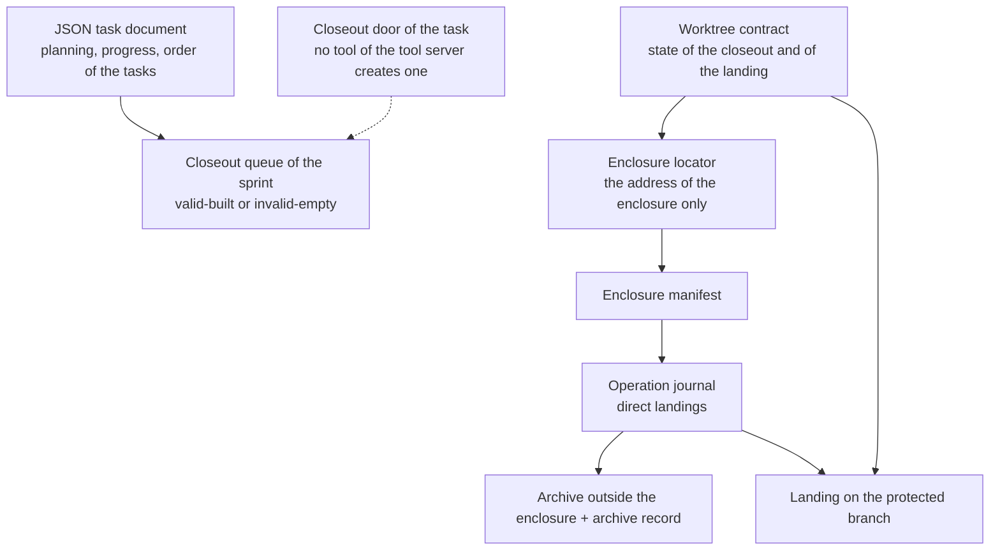

# Worktrees And Closeout

The worktree tools create a task's worktrees, find the task's [enclosure](../concepts.md#enclosure)
again from its exact address (see [Stable Address And Enclosure](#stable-address-and-enclosure)),
land the task, archive the enclosure's records at the end, and clean up. The
[authorized closeout operation](https://github.com/Foxfire1st/agents-remember/blob/main/skills/l-01-agent-lifecycles/operations/closeout.md)
of the skill keeps three rules: a closeout commits exactly the code and memory input that was
validated and accepted, unchanged; it commits only after approval; and it commits the code before
the memory. What a closeout or a landing may commit is decided by the
accepted pair of a code commit and a memory commit, their ancestry and the Git refs that the tools
recorded. The file `memory.md`, the [memory attribution cache](../concepts.md#memory-attribution-cache),
is ignored by Git and computed from the trailers of memory commits; nothing in it allows or blocks a
closeout or a landing.

## When To Use It

Use the worktree tools under their [lifecycle authority](https://github.com/Foxfire1st/agents-remember/blob/main/skills/l-01-agent-lifecycles/operations/closeout.md) when:

- a task needs isolated code and memory worktrees;
- a closeout needs code and memory commits mapped in `memory.md`;
- a task's lifecycle state must be read by its address, or an interrupted direct landing recovered;
- you want explicit preview, approval, landing, and cleanup boundaries.

## One Owner Per Plane



Each box has one owner. The [closeout door](../concepts.md#closeout-door) of a task is the record
by which the task waits for closeout, in the file `<enclosure>/reports/closeout-door.json`.
The file holds the current closeout-door generation. A generation is one version of the record: it
carries a `generationId`, and a change of its disposition rewrites the same generation; a new generation names the one before it in
`predecessorGenerationId`. A generation has one of the dispositions `waiting`,
`deferred`, `withdrawn` or `claimed`. No tool of the tool server creates a closeout door, and
`worktree_closeout_apply` reads none; the dashed arrow shows that the closeout queue reads the
waiting doors. The
[closeout queue](../concepts.md#closeout-queue) of a sprint lists the tasks whose door waits and is
rebuilt from the task documents and the waiting doors; without a door it lists no task. The worktree
contract records the state of the task's closeout and of its landing, and `worktree_integrate` lands
the closeout that the contract records. The enclosure locator, the enclosure manifest and the
[operation journal](../concepts.md#operation-journal) find a task's enclosure, and the journal
records each direct landing (see
[Stable Address And Enclosure](#stable-address-and-enclosure)); the archive and its
[archive record](../concepts.md#archive-record) keep them after cleanup (see
[Terminal Cleanup](#terminal-cleanup)). A landing moves the protected branch it lands on one task
at a time (see [Landing Serialization](#landing-serialization)).

Task documents remain writable during every closeout phase. `worktree_closeout_apply` runs the
whole closeout inside the call: it spends the approval of the closeout, commits the code, commits
the memory and records the closeout in the worktree contract. Nothing runs after the call returns.

The closeout queue contains only the current `waiting` closeout-door generations. It never owns
selection history, attempts, commits, recovery, landing, or audit: the worktree contract holds the
state of a closeout, and the operation journal holds a direct landing, whether the closeout queue
is `valid-built`, `invalid-empty` or absent.

## Stable Address And Enclosure

The worktree contract of a task, its file `series-contract.md`, is the stable public address: the
worktree tools take its path in `contract_path`, and the path stays the same for the whole life of
the task, also after cleanup and for a successor that reopens it (see the
[worktree contract](../concepts.md#worktree-contract)). `worktree_start` publishes:

1. one enclosure locator for that contract, which holds only the address of the enclosure;
2. one immutable `.lifecycle/enclosure-manifest.json` in the enclosure;
3. the exact initial contract generation;
4. the operation journals of the enclosure as direct landings are accepted.

Lifecycle reads use exactly two strict routes:

```text
live:     contract address -> enclosure locator -> enclosure manifest -> operation journal
terminal: contract address -> enclosure locator (terminal-archived) -> exact external archive
                                            + archive record + surviving contract truth
```

A live read follows the contract's address to the enclosure locator, from there to the enclosure
manifest, and from the manifest to the operation journal. A terminal read, after cleanup, follows the
address to the enclosure locator in the state `terminal-archived`, and from there to the archive
outside the enclosure, its archive record and the state that the worktree contract keeps.

Attach, operation control, and live recovery use only the live route. A terminal enclosure locator
is never reinterpreted as permission to follow the old path of the enclosure: the archive
preserves the collected manifest and journal, and the configured contract supplies current cleanup
truth. Neither route scans task documents or worktree folders, infers a name, trusts an enclosure
path that the caller supplies, or uses `reports/` as lifecycle authority.

`worktree_status` is the public status action for either route. In the live state it reports, for
a direct landing, the current journal generation and the executable controls. In the terminal state it distinguishes
archive-ready from cleanup-completed and reports the surviving contract state; it does not claim
that the old enclosure remains addressable. If the enclosure locator is archive-ready but contract cleanup is
not yet `completed` or `abandoned`, retry the archive's exact accepted public disposition with its
archived arguments: `worktree_cleanup` with the accepted `teardown_providers` value or
`worktree_abandon` with the accepted `force` value. The archive request identity durably binds this
typed `cleanupArguments` object. Status and terminal-request conflicts return it with the exact
public `nextArgs`; a retry with different arguments refuses rather than revising, defaulting, or
falling back. Do not route that terminal retry through `worktree_operation_control`.

## Task Mutation And Closeout Queue Rebuild

A `task_doc` write that is valid in itself is written first. In the same step the tool takes every
sprint that governed the task before or after the write, marks the closeout queue of each as
`invalid-empty`, a state in which the queue lists no task, and rebuilds each queue on its own
from the current task documents and the current waiting closeout doors. The answer's
`projectionEffects` names each sprint and carries an exact `nextAction` when a rebuild did not
finish.

Run the call that `nextAction` names: `closeout_queue` with `action: "rebuild"` and the sprint's
`sprint_task_document_ref`. Do not reject or roll back the task write, and do not keep a closeout
queue that is out of date. The closeout queues of unrelated sprints and repositories keep their
revisions.

## Closeout And Recovery

Requested certification runs through Dagger and commits nothing. A
[certification](../concepts.md#certification) is a full run of a code repository's checks and
tests that a person asks for. The
[repository certification profile](repository-certification-profile.md) and its loader govern that
explicitly requested work, not ordinary closeout.
Ordinary closeout runs no gate but the invariant gate: it judges the exact code/memory pair
and publishes the authorized Git transaction without running the
[certification gates](../concepts.md#certification-gate),
code-quality checks, test suites, or independent review. Missing certification profiles or
results do not block this transaction. A closeout also runs the pre-commit hook of the repository
on each tree that it commits; see below.

That gate is the [knowledge gate](../concepts.md#knowledge-gate) of the
[knowledge system](knowledge-system.md#worklist-validator-and-gate); "invariant gate" is the word
of the product's refusal text. `worktree_closeout_preview`
and `worktree_closeout_apply` read one verdict on the task's code candidate tree and memory tree,
so a preview does not promise a closeout that the apply refuses. A refusal is
`knowledge-gate-refused` and carries its findings.

The same verdict checks the catalogue `entities.md` of the memory against the code candidate. A
row that cites a file the code candidate does not hold refuses the closeout at the preview,
before the code commit, and nothing is committed on either side. The refusal names the catalogue
file, the row and the missing paths. It says to re-point the row's evidence list to files the
candidate holds.

A [route review](../concepts.md#route-review) is the verdict of the
code review of the task, which the Reviewer records after that review with the `task_doc` operation
`record_route_review`. `worktree_closeout_preview` and `worktree_closeout_apply` do not read it:
they refuse no candidate for a missing, blocking or stale route review. After a `worktree_sync` in
which the incoming line changed no path that the reviewed change touched, the Worker runs its
focused tests once more, and no new review round opens. Its focused tests are the tests that its
instructions choose by searching the repository's test files for each path and name the change
touches.

One part of Agents Remember, the publication owner, writes the commits of a closeout and of a
direct landing. It writes the judged tree as a commit object with `git commit-tree`, with the branch head
that the tools admitted as its parent, and then moves the branch only if the branch still points
to that head (an expected-old ref transaction). It holds a per-worktree lock,
refuses a conflict or a moved ref, gives the index back as it found it, and keeps recoverable
evidence for each leg, the code commit and the memory commit. Git runs no commit hook for
`commit-tree`. A `reference-transaction` hook of the repository, which Git runs whenever a ref
moves, still runs when the branch moves and may refuse the move.

Because Git runs no commit hook for `commit-tree`, the publication owner runs the pre-commit hook
of the repository itself, before it writes a commit. It resolves the hook as Git does
(`core.hooksPath`, else the hooks folder of the repository) and starts it with the index holding
exactly the tree to be published. The landing is refused and no ref moves when the hook fails,
when its run changes the index or a tracked file, when it cannot run, or when it does not end
within `orchestration.landing.commitCheckTimeoutSeconds` of the
[settings reference](settings-json.md). A commit that the closeout or `direct_landing` writes
after a passed check carries the trailer `Commit-Check-Pass: tree=<tree> hook=<hook>`; `hook` is
`none` for a repository without a pre-commit hook. `worktree_integrate` accepts a commit whose
trailer names the tree of that commit, and it runs the hook itself on a candidate without such a
trailer. The commit of `memory_baseline_adopt` passes the same check and carries the trailer
`Code-Commit:` only. No argument of these tools skips the check.

`worktree_closeout_apply` first validates every enabled explicit nonblank commit message. Then it
runs the whole closeout inside the call: the approval of the closeout, the code commit, the memory
commit and the record in the worktree contract. It answers the state reached, `closed` or a
refusal such as `blocked` or `closeout-gate-blocked`. Nothing runs after the call returns, and
there is nothing to poll. The closeout reads no [closeout door](../concepts.md#closeout-door), and
no tool of the tool server creates one.

`worktree_status` reports the state of the task and, for a direct landing, its current generation
in the operation journal with the `worktree_operation_control` action that it names. That tool
controls one run that the journal records (`operation_kind` `closeout`, `integrate` or
`direct-landing`): its `action` is `retry`, `recover`, `resume`, `cancel`, `retire` or
`supersede`, and it also takes `contract_path`, `expected_generation` and `intent_note` (see
[Closeout and landing](mcp-tools.md#closeout-and-landing)). Only a direct landing leaves a run in
the journal. For `operation_kind` `closeout` or `integrate`, a request that passes the checks of
its shape, its contract and its caller is refused with `lifecycle-operation-missing`. For a direct
landing, a failure before any output may retry the same input or cancel; a changed input needs a
new `direct_landing` call, because `supersede` is refused for a direct landing with
`lifecycle-direct-supersede-unavailable`. Ambiguous or proven output must recover the same
generation. Rows of the closeout queue, raw Git,
repeat-from-scratch, reports, and journal edits are not recovery paths.

## Raw Git Identity Boundary

A task's declared identities are the three commits that a review of the task was recorded
against: the head of the work branch, the code-base commit that the capture was taken from, and the
recorded base of the memory work branch. `worktree_sync` is the only route that moves them *under
measurement*: it merges the [official line](../concepts.md#official-line) into the work branch,
re-captures the candidate, and records a rebinding that names what moved. Everything else that can
move them is ordinary Git, and ordinary Git leaves no record behind.

The review surface therefore measures the boundary itself. It asks each declared identity of the
repository that it names, and it states which of them the repository no longer shows. A retained
uncommitted candidate supplies a tree pin without an observed work-branch head; that ancestry
channel reports `not-measured` rather than filling the missing head from today's checkout.

The boundary performs no reconciliation. A replaced identity marks the review stale, disables
submission against it and names the identity that was replaced. The reviewed comparison generation
stays exactly where it is, so it stays inspectable. A boundary that could not take its comparison
at all renders `not-measured` with the reason rather than a current review: a checkout that left
its declared branch, a recorded object that is gone, or a generation that could not be read. It
does not disable submission, because no movement was observed.

The same statement is attached to the closeout and landing results. There it is a statement and
never a gate: it refuses nothing, and the closeout's and the landing's own source-lineage checks
remain the only checks on that transaction.

The table below is the support matrix of the product: the code holds the same table, and the
review states each boundary by one of its rows. The shapes are the ones a repository's own history
can show, `unchanged` is the measured absence of any of them, and the four this system does not
reconcile say so rather than being implied by omission. In the column "Boundary state", `current`
means that no declared identity was replaced, `stale` means that one was replaced and the review
can no longer be submitted against, and `not-measured` means that the comparison could not be
taken.

| Transition | Measured signature | Boundary state | Reconciliation | Recovery |
| --- | --- | --- | --- | --- |
| `unchanged` | every declared identity is still exactly the identity the comparison recorded: the candidate commit, the code-base commit and the memory work branch's base are all at their recorded values, so nothing was observed to move | `current` | **supported** | none required for the declared identities; this boundary compared all of them and found each still exactly where the reviewed tree comparison recorded it, so no shape was observed to reconcile |
| `ordinary-append` | the recorded candidate commit is still an ancestor of the branch tip and the tip has moved past it: the branch advanced without replacing anything the comparison recorded | `current` | **supported** | none required for the recorded identities; the branch moved forward from the recorded candidate commit without replacing it, which is the ordinary shape of work continuing under an already-recorded tree comparison |
| `rebase` | the recorded candidate commit is a readable commit object that is not an ancestor of the branch tip, so the branch was rewritten | `stale` | **unsupported** | open a new live review from the rebased tip to record the exact successor tree comparison; the previous comparison remains inspectable, and this system does not replay or reverse a rebase |
| `cherry-pick` | the branch tip differs from the recorded candidate commit while the recorded candidate commit is still an ancestor, or the code and memory trees differ while both commits still resolve | `current` | **unsupported** | record a successor tree comparison from the advanced tip -- the pick is never identified from an ancestry check alone, and no record that already exists measures it: the managed-sync rebinding exists only once a sync has carried the official line and resolved a pair, the reopen channel reports the recorded comparison's availability rather than the pick, and this boundary's own state stays 'current'. A sync that carries nothing resolves no pair and records no rebinding, so it is not a measurement of the pick either |
| `revert` | the branch advances by exactly the commits that undo earlier ones: the recorded candidate commit stays an ancestor and no ancestry check can tell the undo from any other new commit | `current` | **unsupported** | record a successor tree comparison from the branch as it now stands; a revert is never inferred from an ancestry check, and the code tree and memory candidate tree this boundary does not compare are the existing owners' measurements to take |
| `branch-switch` | the code worktree is not on the branch the contract declared -- a detached HEAD or another branch -- so the work-branch comparison cannot be taken at all | `not-measured` | **unsupported** | return the worktree to its declared work branch, then read the boundary again; this system never checks a branch out on a reader's behalf and never mutates a checkout |

The recovery is a new live review that records the exact successor code and memory tree comparison.
The previous tree comparison remains retained evidence. A boundary that could not compare a channel reports
that absence with its reason instead of a verdict, and no state that was not measured is rendered as
one that was.

## Landing Serialization

`worktree_integrate` lands the closed task into its configured source branch. It preserves
same-target protected-ref serialization, current code+memory base-pair admission,
`worktree_sync`, irreversible-edge revalidation, and atomic-blocker exclusion. Those rules may
refuse only the conflicting landing edge; they never veto task authoring.

`worktree_integrate` runs the landing inside the call and leaves no record in the operation
journal. The closeout queue is not involved.

A task can land no commit: its landing equals the code and memory pair it started from or was
last synced to. Such a task keeps its place on the master's line. The answer of
`worktree_integrate` or `worktree_record_landing` then carries `emptyLanding: true`: the landing
added no commit. The closeout preview of the master lists the ids of these tasks in
`emptyLandings`, because they stand on the master's line without a commit of their own and so
without a place in the order of its commits.

A master whose tasks were published through pull-request merges can close out. The closeout
checks the master's line step by step and admits a merge commit of exactly this shape: it has two
parents, the second parent is the landed commit of one task, that commit descends from the first
parent, and the tree of the merge equals the tree of that commit. A merge of any other shape is
not admitted as a publication. [The landing workflow of a repository](../workflows.md#the-landing-workflow-of-a-repository)
describes how a repository lands by pull request.

When a landing makes documents stale, the answer of `worktree_integrate`,
`worktree_checkpoint_landing`, `worktree_record_landing` or `direct_landing` carries
`staleDocuments`: the `count`, the `documents` and the `knowledge_read` call that lists them
(`view: "dependent"` with `staleOnly: true`). When the staleness cannot be computed at all, the
field holds `state` (`uncomputable`) and `detail` instead. When the state of some documents cannot
be established, it holds `state` (`unverifiable`) and `detail` beside `count` and `documents`. An
ordinary landing is not refused for stale documents or for a state it could not read. Only the
landing that finishes a master is refused: with `knowledge-dependents-stale-at-master-end` while a
document that this master made stale is still stale, and with `knowledge-worklist-incomplete` or
`knowledge-unverifiable-at-landing` when that state could not be computed or established.

## Terminal Cleanup

The enclosure contains canonical live evidence, so final cleanup cannot delete it merely
because task status says completed. The terminal operation must:

1. prove the exact operation generation terminal;
2. archive the canonical manifest and operation journal outside the deletion target;
3. read back and verify the exact archive bytes;
4. publish the [archive record](../concepts.md#archive-record), the receipt that the archive was
   read back, and move the enclosure locator to its terminal state;
5. only then delete worktrees, merged branches, disposable reports, and the enclosure.

Publishing and reading back the bytes of the archive and of its record does not switch routes by
itself. Until the enclosure locator advances, the live enclosure locator remains authoritative and
an identical accepted `worktree_cleanup` or `worktree_abandon` retry reuses those exact bytes to
finish publishing the terminal state of the enclosure locator. Only an enclosure locator in the
state `terminal-archived` makes the generation archive-ready; that state does not prove that
worktrees, branches, reports, and the enclosure were all removed or that terminal contract truth
was published. After that transition of the enclosure locator, the same disposition retries until
`worktree_status` reports cleanup-completed or abandoned, always using its archived
`cleanupArguments` and exact `nextArgs`. Active or ambiguous evidence is never collectable. After
cleanup, the absence of the enclosure is accepted only when the exact external archive, its record
and surviving contract truth prove deliberate deletion.

A task can get a successor at the same address: `task_reopen` reopens it, or an abandoned task is
started again. The worktree contract of the ended task is then the predecessor: `task_reopen` or
`worktree_abandon` left it in a state that admits a restart, and its bytes at the contract's
address are its tombstone. The successor needs the terminal proof above and that exact predecessor
contract, both checked under one short compare-and-swap. The manifest of the successor's enclosure
keeps the link to the archive of the predecessor. Once the successor is reserved, its publication
replaces, in one step, exactly the accepted tombstone bytes at the stable contract address. A
repeat that finds the successor's accepted bytes already there changes nothing; any other bytes
found there refuse.

## Approval Boundary

Implementation approval is not commit approval. Preview the applicable worktree operation first.
A step inside a master, such as the landing of one of its tasks, may proceed under an authority
that you delegated for the master and that its task document records. A standalone task, the
final landing of a master, and the approval gates that only you decide (`integration-approval`,
`push-approval` and `cleanup-approval`) need your explicit decision. An approval does not lock a
task document, and it does not replace the recovery of an operation.

## What the Result Blocks Say

Delivered against reviewed: after a closeout or a landing has committed, the answer of
`worktree_closeout_apply` or `worktree_integrate` says
whether the code and the memory that were delivered are exactly what the task's latest recorded
review showed: the same, different (and on which side), or no review was recorded. It never
blocks.

Sync movement: after a `worktree_sync` has changed a task's code or memory, the answer of
`worktree_sync` and the review page say that the latest recorded review was made before the sync, and offer to record a new one. It
never blocks. A closeout does not read the recorded route review either; see
[Closeout And Recovery](#closeout-and-recovery).

What they do not say: both compare trees, not branch history. A rebase, cherry-pick or revert
that ends in the same tree reads as the same. How a branch got there is not measured.
